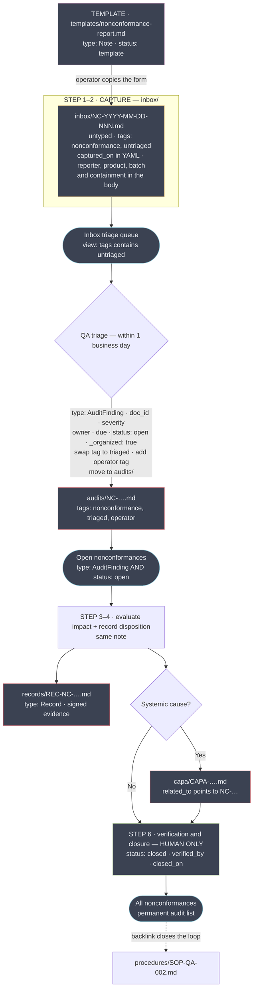
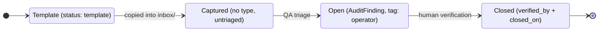

# Nonconformance lifecycle

From the reusable **template** to a **closed report** — the operational path defined in [[SOP-QA-002]] step 2.

## Process flow

## Status transitions of the incident note

## Reading the diagram

- The **template** is never a record: `status: template`, `type: Note`. It is only a form to copy.
- **Capture** produces an untyped note in `inbox/`. It is not yet in the controlled register.
- **Triage** is the only moment the note becomes a controlled `AuditFinding` — and when the `operator` tag is added.
- The **Record** note is the proof; the **CAPA** is optional and only for a systemic cause.
- **Closure is human-only** — the agent rules in `AGENTS.md` forbid setting `status: active` or closing a CAPA.
- The backlink to [[SOP-QA-002]] closes the loop: the procedure shows the findings raised against it.

## Worked examples in this vault

| Stage | Note |
|---|---|
| Template | [[nonconformance-report]] |
| Captured, untriaged | [[NC-2026-11-19-002]] |
| Triaged, open | [[NC-2026-11-19-001]] |
| Disposition evidence | [[REC-NC-2026-11-19-001]] |
| CAPA link | [[CAPA-2026-002]] |
