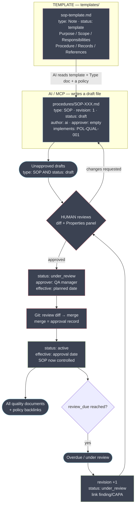
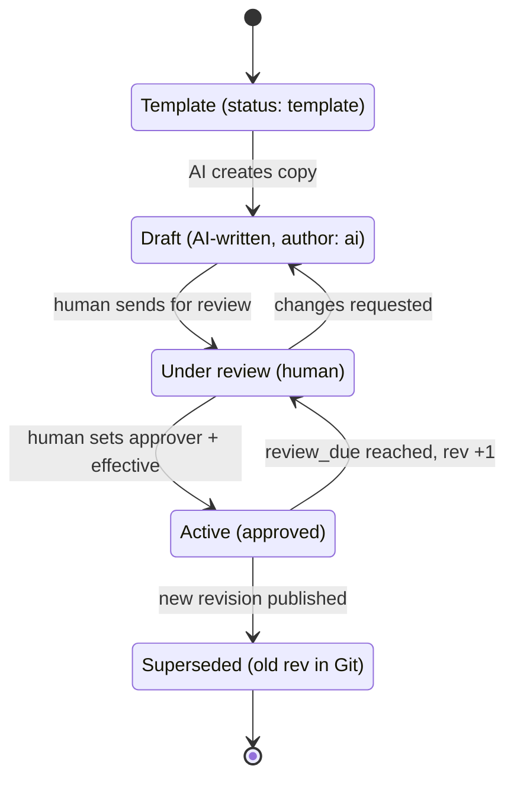

# SOP lifecycle — template to controlled document

How `templates/sop-template.md` becomes an active SOP, and where the human approval gate sits. The step-by-step interaction is in **"Drafting an SOP with AI"** in the vault README; the prompt to paste is [[ai-sop-draft-prompt]].

## Lifecycle flow

## Status transitions of the SOP note

## Reading the diagram

| Colour | Stage | Who acts |
|---|---|---|
| 🟣 Purple | Reusable form — never a record | — |
| 🔵 Blue | Draft written from the template | AI / MCP |
| 🔴 Red | Review, approval decision, Git merge | **Human only** |
| 🟢 Green | Controlled and active | QMS |
| 🔵 Cyan | Computed views | Tolaria |

- The **template** is a starting shape, not a controlled document (`status: template`).
- **AI/MCP writes only `status: draft`** notes with `author: ai` and an empty `approver`.
- The **merge of the reviewed diff is the approval event**; that is why Git matters for AI here.
- **Only a human** sets `status: active`, `approver` and `effective`. This rule is in `AGENTS.md`.
- When `review_due` arrives, the SOP re-enters review at `revision + 1`; the old revision stays in Git history.

## Related

- [[sop-template]] — the source form
- [[ai-sop-draft-prompt]] — the prompt that performs the first transition
- [[SOP-QA-001]] — house-style example of a controlled SOP
- [[POL-QUAL-001]] — the policy a new SOP implements
