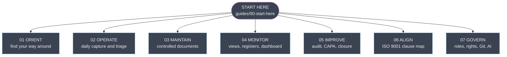
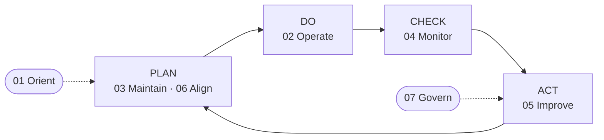

# Working with the QMS vault — start here

This is the operating manual for the people who **run** the QMS, not just read it. Each page covers **one top-level pathway**. From any page you can go deeper into the existing notes, and always find your way back here.

> **Analogy — the airport terminal map.** You are standing in the terminal. Each gate is a pathway (Orient, Operate, Maintain, Monitor, Improve, Align, Govern). You only need the gate for the job you are doing today. Every gate has a sign pointing back to the terminal. You do not need to memorise the whole airport.

## The seven top-level pathways

## The same pathways as a PDCA cycle

A QMS is the Plan–Do–Check–Act loop made visible. Orient and Govern are the frame around it.

## Full branch tree

Each tier below has its own page, and each branch has its own page with one flowchart, an analogy, a *Try it* exercise and links back.

```mermaid wide
flowchart TD
    H(["00 Start here"])
    H --> T1["01 Orient"]
    H --> T2["02 Operate"]
    H --> T3["03 Maintain"]
    H --> T4["04 Monitor"]
    H --> T5["05 Improve"]
    H --> T6["06 Align"]
    H --> T7["07 Govern"]

    T1 --> A1["01.1 note anatomy"]
    T1 --> A2["01.2 types & taxonomy"]
    T1 --> A3["01.3 views & navigation"]
    T1 --> A4["01.4 wikilinks & backlinks"]

    T2 --> B1["02.1 capture"]
    T2 --> B2["02.2 triage"]
    T2 --> B3["02.3 disposition & evidence"]

    T3 --> C1["03.1 policies"]
    T3 --> C2["03.2 SOPs"]
    T3 --> C3["03.3 work instructions"]
    T3 --> C4["03.4 revisions & Git"]
    T3 --> C5["03.5 templates & AI"]

    T4 --> D1["04.1 saved views"]
    T4 --> D2["04.2 register sheets"]
    T4 --> D3["04.3 dashboard"]
    T4 --> D4["04.4 validator"]

    T5 --> E1["05.1 internal audit"]
    T5 --> E2["05.2 findings"]
    T5 --> E3["05.3 CAPA lifecycle"]
    T5 --> E4["05.4 verification & closure"]

    T6 --> F1["06.1 ISO 9001:2026"]
    T6 --> F2["06.2 legacy 2015 clauses"]
    T6 --> F3["06.3 migration path"]

    T7 --> G1["07.1 roles & people"]
    T7 --> G2["07.2 RACI"]
    T7 --> G3["07.3 permissions & AI/MCP"]
    T7 --> G4["07.4 Git audit trail"]

    classDef hub fill:#3B4252,stroke:#B48EAD,color:#ECEFF4
    classDef tier fill:#3B4252,stroke:#88C0D0,color:#ECEFF4
    classDef branch fill:#2E3440,stroke:#4C566A,color:#D8DEE9
    class H hub
    class T1,T2,T3,T4,T5,T6,T7 tier
    class A1,A2,A3,A4,B1,B2,B3,C1,C2,C3,C4,C5,D1,D2,D3,D4,E1,E2,E3,E4,F1,F2,F3,G1,G2,G3,G4 branch
```

Use the **Guides & onboarding** saved view to see all **71 guide pages** in one list: this hub, 7 tier pages, 27 branch pages, and 36 level-3 pages. Level 3 exists only where a branch genuinely needed splitting — look for a *Level 3 branches* section on those pages. Other branches are already a single clear task and stay at level 2.

## Pick your job today

| If you need to… | Go to |
|---|---|
| Find a document or understand a note | [[01-orient]] |
| Log a problem raised on the floor | [[02-operate]] |
| Write or revise a policy / SOP | [[03-maintain]] |
| Check what is overdue or open | [[04-monitor]] |
| Raise a finding or close a CAPA | [[05-improve]] |
| Cite or migrate an ISO clause | [[06-align]] |
| Know who may approve what | [[07-govern]] |

## Rules of the road

1. **One page, one pathway.** Do not mix "how to find" with "how to approve".
2. **Types, not folders, are the real structure** — every note carries `type:` in frontmatter. Folders help humans and a future website.
3. **Frontmatter is the card catalog; the body is the book.** Search the fields, read the prose.
4. **Go deeper only when you need to.** Each pathway page links onward to the worked examples and diagrams that already exist.
5. **Only a human approves.** AI and MCP may write drafts; `status: active` and CAPA closure are human-only.

> This is the **top-level tier only**. The deeper branches (individual procedures, records, clause notes) are reached through the links on each pathway page.
