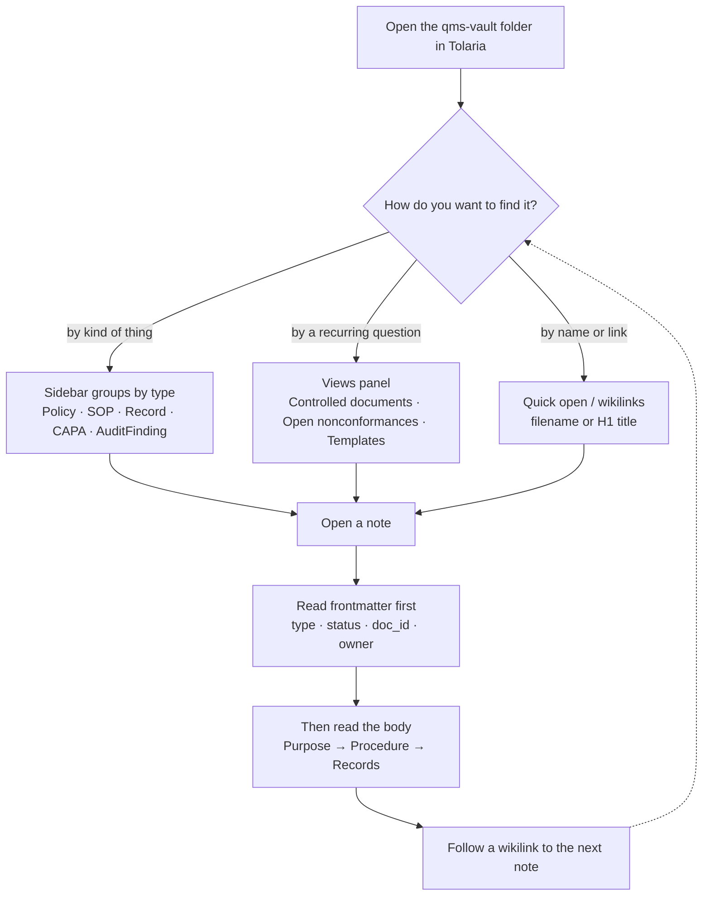

# 01 — Orient: find your way around

**Question this page answers:** *"Where is it, and what am I looking at?"*

## The pathway

## Analogy

> **Library card catalog and the book.** The frontmatter is the index card: edition, owner, due date, shelf. The body is the book itself. You search the cards, not every page of every book. Types are the catalog drawers; Views are pre-written search slips you keep reusing.

## Why / when / who / where

| | |
|---|---|
| **Why** | A QMS fails when nobody can find the current version. Structure kills that. |
| **When** | On first opening the vault, and any time you need to locate a document. |
| **Who** | Everyone — managers, auditors, operators, AI agents. |
| **Where** | Sidebar (Types), Views panel (`views/`), quick open, and wikilinks in note bodies. |

## Branches from here

- [[01.1-anatomy-of-a-note]] — read a note correctly
- [[01.2-types-and-taxonomy]] — how types work
- [[01.3-views-and-navigation]] — saved questions
- [[01.4-wikilinks-and-backlinks]] — the graph

## Go deeper

- [[sop-template]] — see how a reusable form looks in Tolaria
- [[sop-lifecycle]] — a worked diagram of one document's life
- [[nc-lifecycle]] — the operational pathway in detail
- [[iso-9001-map]] — the clause reference map

## Back

[[00-start-here]] — return to the top-level map.
