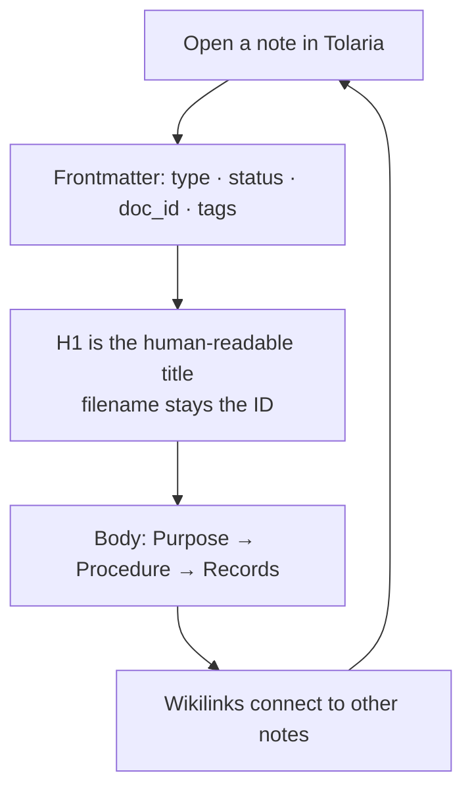

# 01.1 — Anatomy of a note

**Question this page answers:** *What am I looking at when I open a note?*

## The pathway

## Analogy

> A note is like a **passport**: the front page is the machine-readable identity, and the pages inside tell the story. You scan the identity first, then read the story.

## Why / when / who / where

| | |
|---|---|
| **Why** | Because the same file must be readable by a human, a view, a script and an auditor. |
| **When** | Every time you open a note to work on it or trust it. |
| **Who** | Everyone, including AI agents that read frontmatter before body. |
| **Where** | Settings / vault: any note. |

## Try it

Open [[POL-QUAL-001]], press `Cmd+Shift+I` for the Properties panel, and name the four fields. Then toggle raw mode (`Cmd+\`) to see the same values in YAML.

## What you'll see in Tolaria

- Properties panel shows structured fields
- Raw mode shows the `---` frontmatter block
- Breadcrumb shows the filename, H1 shows the title

## Go deeper

- [[POL-QUAL-001|Policy with a clear frontmatter/body split]]
- [[SOP-QA-001|Procedure with traceability links]]
- [[Record|The Record Type document]]

## Back

[[01-orient]] — parent pathway · [[00-start-here]] — hub
