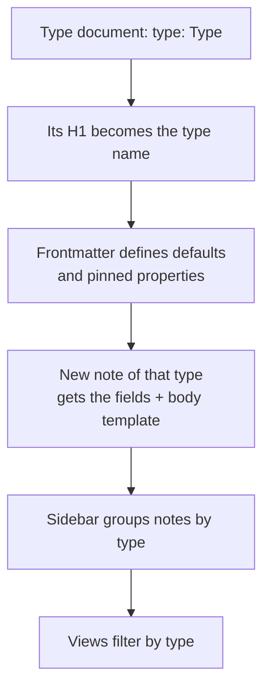

# 01.2 — Types and taxonomy

**Question this page answers:** *How does Tolaria know what kind of thing a note is?*

## The pathway

## Analogy

> A **hospital form library**: an intern may fill out an approved form, but cannot invent a new one called 'Vibes Check'. The Type is the form library.

## Why / when / who / where

| | |
|---|---|
| **Why** | Type — not folder — is the semantic structure Tolaria uses for sidebar, filters and templates. |
| **When** | When creating a document or wondering why a note appears in a certain group. |
| **Who** | QA manager designs types; everyone uses them. |
| **Where** | `types/` folder; Ctrl/Cmd+K → New Type. |

## Try it

Open `types/SOP.md`. Find the H1, `_pinned_properties`, and the template-like body headings after it.

## What you'll see in Tolaria

- Type documents are ordinary Markdown notes
- Moving a file does not change its type
- New notes inherit defaults from the Type

## Go deeper

- [[SOP|SOP Type document]]
- [[Policy|Policy Type document]]
- [[AuditFinding|AuditFinding Type document]]
- [[sop-template|Standalone copy-paste form]]

## Back

[[01-orient]] — parent pathway · [[00-start-here]] — hub
