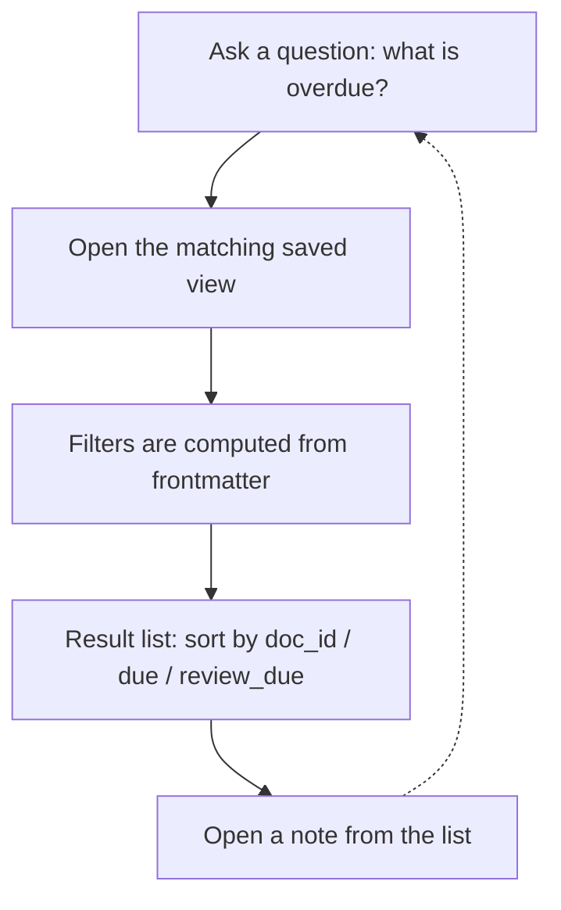

# 01.3 — Views and navigation

**Question this page answers:** *How do I get a list that answers a recurring question?*

## The pathway

## Analogy

> A saved view is a **pre-written search slip** you keep at the library desk, or a preset camera angle on the control tower. Nobody has to re-write the search each morning.

## Why / when / who / where

| | |
|---|---|
| **Why** | Because a human-maintained list goes stale; a computed view cannot. |
| **When** | Daily at the start of a shift; before an audit. |
| **Who** | QA manager reviews; stakeholders read. |
| **Where** | `views/*.yml`; Views panel in Tolaria. |

## Try it

Open *Controlled documents*, then *Overdue / under review*. Notice the second list changes as dates pass.

## What you'll see in Tolaria

- Views are plain .yml files in views/
- Filters use all / any logic
- Sort uses `property:FIELD:ASC_OR_DESC`

## Level 3 branches

- [[01.3.1-filter-operators]]
- [[01.3.2-sorting-a-view]]
- [[01.3.3-view-file-anatomy]]

## Go deeper

- [[document-master.sheet|The register behind the list]]
- [[qms-overview|Dashboard view of the same data]]
- [[04.1-build-a-saved-view|How views are built]]

## Back

[[01-orient]] — parent pathway · [[00-start-here]] — hub
