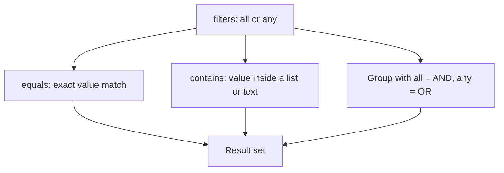

# 01.3.1 — Filter operators

**Question this page answers:** *How do I say exactly what a view should show?*

## The pathway

## Analogy

> **All is AND, any is OR** — like a form that says 'tick every box' versus 'tick at least one box'.

## Why / when / who / where

| | |
|---|---|
| **Why** | A view whose logic is wrong returns a plausible but misleading list. |
| **When** | Whenever you build or edit a view. |
| **Who** | QA manager; anyone reading the result. |
| **Where** | `views/*.yml`; Reference → View Filters. |

## Try it

Open `views/nonconformances-open.yml` and say its logic out loud: type equals CAPA AND status equals open.

## What you'll see in Tolaria

- Operators are plain YAML under filters
- contains works on tags arrays
- Keep one view = one question

## Go deeper

- `views/nonconformances-open.yml` — Two equals filters with all
- `views/nc-triage.yml` — contains on tags
- [[01.3-views-and-navigation|Parent view page]]

## Back

[[01.3-views-and-navigation]] — parent page · [[01-orient]] — tier overview · [[00-start-here]] — hub
