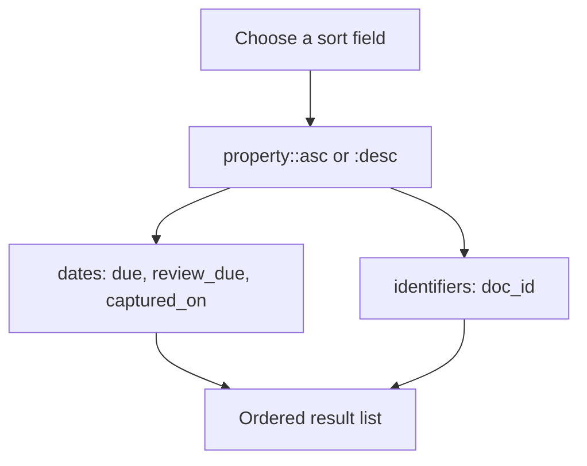

# 01.3.2 — Sorting a view

**Question this page answers:** *How do I make the most urgent row appear first?*

## The pathway

## Analogy

> **Sorting is the queue discipline** — same people in the room, but the one with the earliest deadline stands at the front.

## Why / when / who / where

| | |
|---|---|
| **Why** | An unsorted list hides what needs action today. |
| **When** | When a view is used for triage or escalation. |
| **Who** | QA manager. |
| **Where** | Top line of each `views/*.yml`. |

## Try it

Open `views/open-capas.yml` and change sort from `due:asc` to `doc_id:asc`; notice what is lost.

## What you'll see in Tolaria

- Only one sort expression per view
- Sort fields must exist on the notes
- Relative dates may need in-app verification

## Go deeper

- `views/open-capas.yml` — Sorted by due
- [[document-master.sheet|ID-based ordering]]
- [[01.3-views-and-navigation|Parent]]

## Back

[[01.3-views-and-navigation]] — parent page · [[01-orient]] — tier overview · [[00-start-here]] — hub
