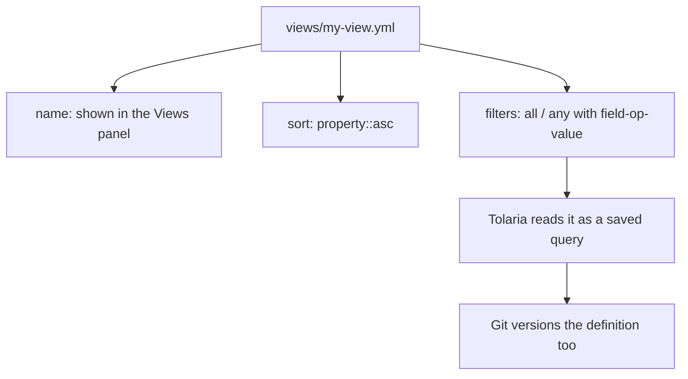

# 01.3.3 — View file anatomy

**Question this page answers:** *What exactly is a saved view on disk?*

## The pathway

## Analogy

> A view is a **recipe card**, not a cooked meal — it describes how to find notes, and the app cooks it fresh every time.

## Why / when / who / where

| | |
|---|---|
| **Why** | Views are files, so they are portable, reviewable and version-controlled like everything else. |
| **When** | When reviewing or sharing a view definition. |
| **Who** | QA manager; Git reviewers. |
| **Where** | `views/` folder. |

## Try it

Open `views/guides.yml` and identify its name, sort and filters.

## What you'll see in Tolaria

- Plain YAML, not proprietary format
- icon and color are optional
- Stored in the vault, not in app settings

## Go deeper

- `views/guides.yml` — Simplest example
- `views/quality-documents.yml` — any-filter example
- [[01.3-views-and-navigation|Parent]]

## Back

[[01.3-views-and-navigation]] — parent page · [[01-orient]] — tier overview · [[00-start-here]] — hub
