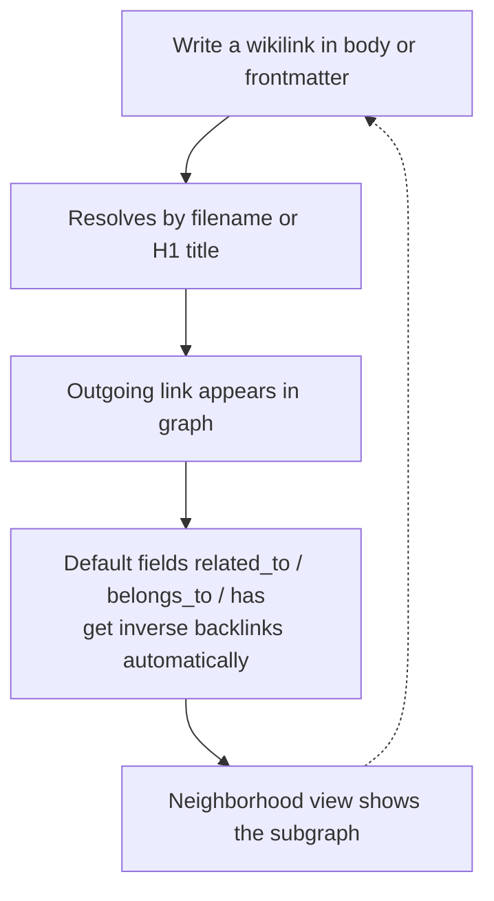

# 01.4 — Wikilinks and backlinks

**Question this page answers:** *How does one document point to another — and back?*

## The pathway

## Analogy

> Like **cross-references in an encyclopedia**, but two-way: the article you point to also shows that you pointed at it.

## Why / when / who / where

| | |
|---|---|
| **Why** | Traceability is the QMS superpower: requirement → procedure → record → finding. |
| **When** | When linking a procedure to its policy, or a CAPA to its evidence. |
| **Who** | Everyone; agents too, via relationship fields. |
| **Where** | Note bodies, frontmatter relationship fields, Neighborhood mode. |

## Try it

Open [[POL-QUAL-001]] and look at its backlinks — the SOPs that implement it appear there automatically.

## What you'll see in Tolaria

- One relationship field, related_to, is used everywhere
- implements keeps the policy link labelled
- Custom relationship names were retired to get inverses

## Level 3 branches

- [[01.4.1-body-links]]
- [[01.4.2-relationship-fields-and-inverses]]
- [[01.4.3-backlinks-and-neighborhood]]

## Go deeper

- [[NC-2026-11-19-001|A note with several relationship links]]
- [[iso2015-7-5-Documented-information|Clause note with a Used by list]]
- [[03.4-revisions-and-git|Where links meet history]]

## Back

[[01-orient]] — parent pathway · [[00-start-here]] — hub
