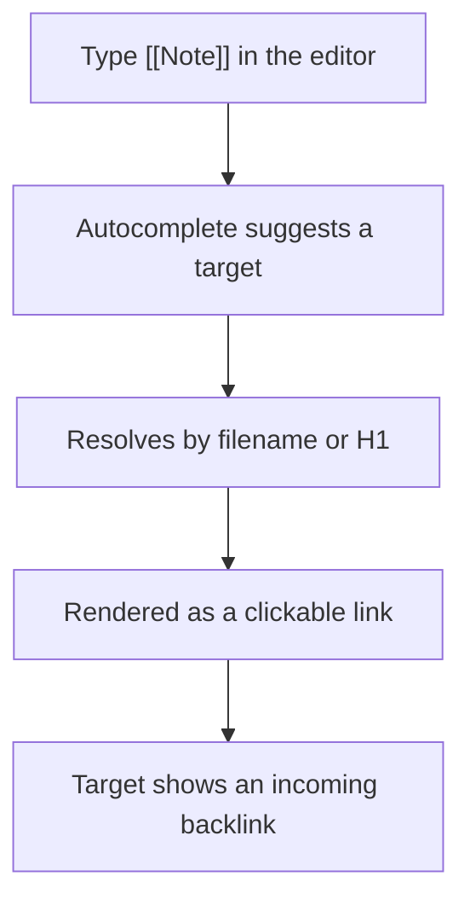

# 01.4.1 — Body links

**Question this page answers:** *How do links inside the text behave?*

## The pathway

## Analogy

> Like a **footnote that works both ways** — the reader can jump forward, and the cited page knows who cited it.

## Why / when / who / where

| | |
|---|---|
| **Why** | Body links are natural in prose; fields are better for filters and navigation. |
| **When** | When explaining a relationship in writing. |
| **Who** | Everyone writing notes. |
| **Where** | Rich editor and raw Markdown. |

## Try it

In [[SOP-QA-001]], click the link to [[POL-QUAL-001]] and check the backlink on the policy.

## What you'll see in Tolaria

- Alias syntax keeps text readable
- Targets can be plain filenames
- Broken links are caught by the validator

## Go deeper

- [[SOP-QA-001|Body links in a procedure]]
- [[POL-QUAL-001|Target with backlinks]]
- [[01.4-wikilinks-and-backlinks|Parent]]

## Back

[[01.4-wikilinks-and-backlinks]] — parent page · [[01-orient]] — tier overview · [[00-start-here]] — hub
