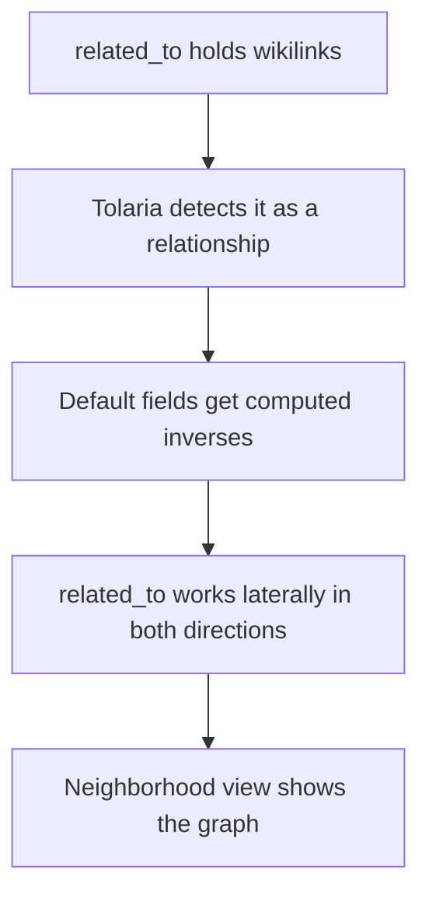

# 01.4.2 — Relationship fields and inverses

**Question this page answers:** *Why use one relationship field instead of many?*

## The pathway

## Analogy

> **One cable with two ends** — plug in once and both sides are connected. Custom-named cables only conduct one way.

## Why / when / who / where

| | |
|---|---|
| **Why** | The simplification you chose trades four labels for automatic backlinks. |
| **When** | When linking a CAPA to a policy, SOP and finding. |
| **Who** | QA engineer; AI agents via frontmatter. |
| **Where** | Frontmatter `related_to`; Properties panel. |

## Try it

Open [[CAPA-2026-002]] and count the entries in `related_to`.

## What you'll see in Tolaria

- implements is the one kept custom label
- Arrays hold multiple targets
- Inverses appear without writing the reverse link

## Go deeper

- [[CAPA-2026-002|Four related links]]
- [[NC-2026-11-19-001|Finding linked to SOP and CAPA]]
- `AGENTS.md` — Rulebook in AGENTS.md

## Back

[[01.4-wikilinks-and-backlinks]] — parent page · [[01-orient]] — tier overview · [[00-start-here]] — hub
