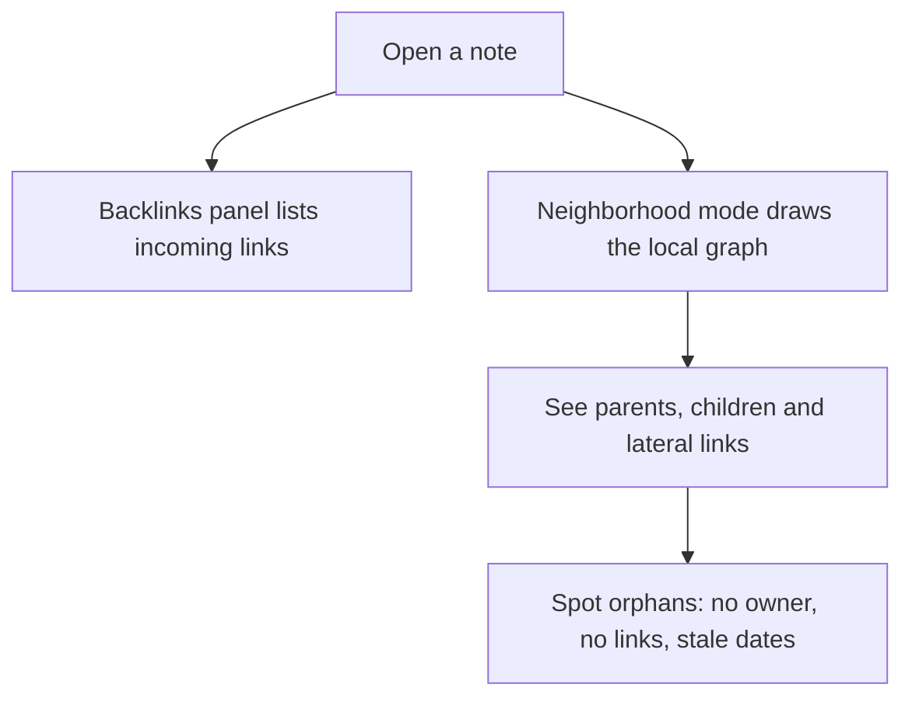

# 01.4.3 — Backlinks and neighborhood

**Question this page answers:** *How do I see everything connected to a note?*

## The pathway

## Analogy

> **Standing in the middle of a family tree** — you see ancestors, descendants and cousins without drawing the whole forest.

## Why / when / who / where

| | |
|---|---|
| **Why** | An orphan document is a QMS defect; the graph makes it visible. |
| **When** | Before a review, or when checking a policy's coverage. |
| **Who** | QA manager; auditors. |
| **Where** | Backlinks panel; Neighborhood mode. |

## Try it

Open [[POL-QUAL-001]] and look at its incoming links from SOPs and CAPAs.

## What you'll see in Tolaria

- Backlinks are computed, not maintained
- Neighborhood is scoped to the selected note
- Cross-vault links need aliases when multiple vaults load

## Go deeper

- [[POL-QUAL-001|Hub of the traceability chain]]
- [[iso-9001-map|Clause note with Used by list]]
- [[01.4-wikilinks-and-backlinks|Parent]]

## Back

[[01.4-wikilinks-and-backlinks]] — parent page · [[01-orient]] — tier overview · [[00-start-here]] — hub
