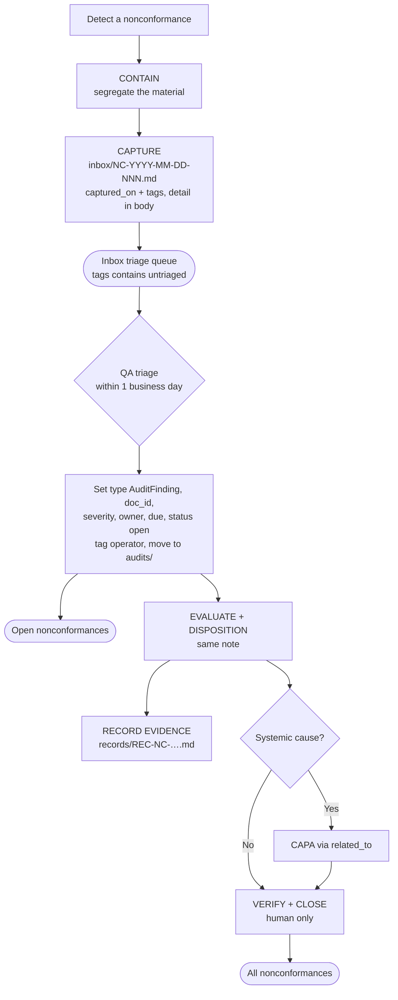

# 02 — Operate: the daily pathway

**Question this page answers:** *"Something went wrong on the floor. What do I do, and where is it logged?"*

## The pathway

## Analogy

> **A suggestion box that actually gets emptied and sorted.** The Inbox is the slot in the wall — fast to use, no perfect form required. Triage is the person who opens the box each morning and files each note properly. The *Record* note is the signed receipt that proves the action really happened.

## Why / when / who / where

| | |
|---|---|
| **Why** | An undocumented problem disappears; a logged problem can be proven fixed. |
| **When** | Same shift as detection; triage within one business day. |
| **Who** | Operator captures; QA engineer triages and investigates; QA manager authorises disposition. |
| **Where** | `inbox/` → `audits/` → `records/` → `capa/`; views `nc-triage.yml`, `nonconformances-open.yml`. |

## Branches from here

- [[02.1-capture-the-condition]] — the Inbox note
- [[02.2-triage-into-a-finding]] — classification
- [[02.3-disposition-and-evidence]] — proof it happened

## Go deeper

- [[nc-lifecycle]] — full Mermaid lifecycle and status transitions
- [[nonconformance-report]] — the capture form to copy
- [[NC-2026-11-19-002]] — an untriaged example
- [[NC-2026-11-19-001]] — the same flow after triage

## Back

[[00-start-here]] — return to the top-level map.
