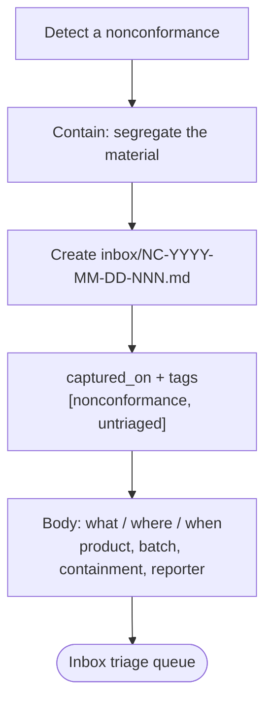

# 02.1 — Capture the condition

**Question this page answers:** *A problem just happened. How do I record it without losing detail?*

## The pathway

## Analogy

> **Drop the letter in the slot before you address the envelope.** Capture is fast and imperfect; the addressing happens in triage.

## Why / when / who / where

| | |
|---|---|
| **Why** | Speed of capture is more important than perfect structure at the moment of discovery. |
| **When** | Same shift, while the facts are fresh. |
| **Who** | Any operator or person on the floor. |
| **Where** | `inbox/`, `templates/nonconformance-report.md`. |

## Try it

Copy the capture form, create a file named for today's date and next sequence number, and fill only the fields you know.

## What you'll see in Tolaria

- No type, no _organized — that is what keeps it in Inbox
- Detail belongs in the body
- captured_on drives the triage sort

## Go deeper

- [[nonconformance-report|Capture form to copy]]
- [[NC-2026-11-19-002|Untriaged worked example]]
- [[02.2-triage-into-a-finding|Next step]]

## Back

[[02-operate]] — parent pathway · [[00-start-here]] — hub
