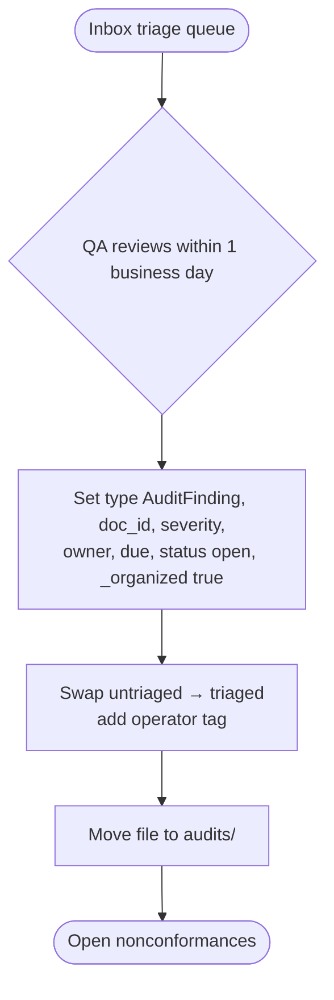

# 02.2 — Triage into a finding

**Question this page answers:** *Who turns a raw capture into a controlled record?*

## The pathway

## Analogy

> **Emergency-room triage**: a quick, consistent classification decides which queue the patient enters. The nurse does not perform the surgery.

## Why / when / who / where

| | |
|---|---|
| **Why** | An untyped capture is not yet controlled; triage is the single moment it becomes an AuditFinding. |
| **When** | Within one business day of capture. |
| **Who** | QA engineer triages; QA manager owns disposition. |
| **Where** | `inbox/` → `audits/`; view `nc-triage.yml`. |

## Try it

Open [[NC-2026-11-19-002]] and write down the exact fields a human must set before moving it.

## What you'll see in Tolaria

- Triage is a human decision
- The operator tag records the source
- After triage the note leaves the Inbox view

## Level 3 branches

- [[02.2.1-assign-type-and-id]]
- [[02.2.2-severity,-owner,-due]]
- [[02.2.3-tags-and-move]]

## Go deeper

- [[NC-2026-11-19-001|Triaged worked example]]
- [[AuditFinding|Type definition]]
- [[04.1-build-a-saved-view|How the queues are built]]

## Back

[[02-operate]] — parent pathway · [[00-start-here]] — hub
