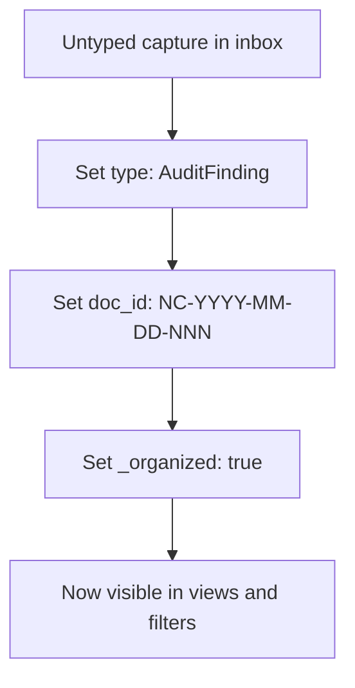

# 02.2.1 — Assign type and ID

**Question this page answers:** *What turns a capture into a controlled object?*

## The pathway

## Analogy

> **Giving a found object a shelf number and a catalogue card** — before that it is just something lying on the desk.

## Why / when / who / where

| | |
|---|---|
| **Why** | Without type and ID the note cannot be filtered, counted or audited. |
| **When** | At triage, once the condition is confirmed. |
| **Who** | QA engineer. |
| **Where** | Properties panel on the capture note. |

## Try it

Open [[NC-2026-11-19-002]] and write the three fields a human must add.

## What you'll see in Tolaria

- Type values are Title Case
- doc_id matches the filename
- _organized marks it as no longer in Inbox

## Go deeper

- [[NC-2026-11-19-001|Already triaged]]
- [[AuditFinding|Type definition]]
- [[02.2-triage-into-a-finding|Parent]]

## Back

[[02.2-triage-into-a-finding]] — parent page · [[02-operate]] — tier overview · [[00-start-here]] — hub
