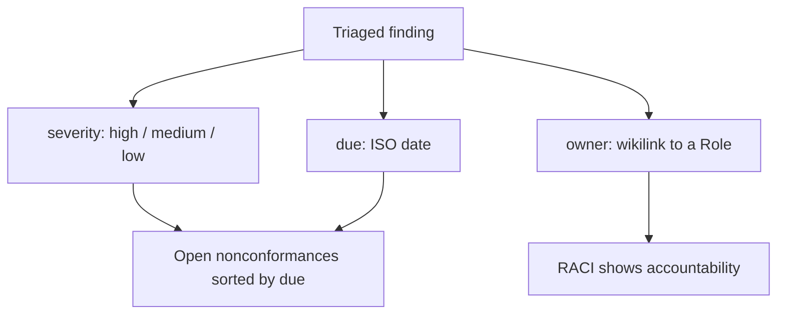

# 02.2.2 — Severity, owner, due

**Question this page answers:** *How is urgency and accountability recorded?*

## The pathway

## Analogy

> **Triage tags at the emergency room**: colour for urgency, named doctor, time target. Without all three, nobody knows who acts first.

## Why / when / who / where

| | |
|---|---|
| **Why** | Severity and due date drive prioritisation; owner makes it somebody's job. |
| **When** | When evaluating the impact of the nonconformance. |
| **Who** | QA engineer assigns; QA manager accepts. |
| **Where** | Properties panel; `views/nonconformances-open.yml`. |

## Try it

On [[NC-2026-11-19-001]], identify severity, owner and due.

## What you'll see in Tolaria

- Dates are plain YAML dates
- Owner points to a Role, not a person
- Due drives the view sort

## Go deeper

- [[NC-2026-11-19-001|Worked example]]
- [[qa-engineer|Owner role]]
- [[raci-obligations.sheet|Accountability matrix]]

## Back

[[02.2-triage-into-a-finding]] — parent page · [[02-operate]] — tier overview · [[00-start-here]] — hub
