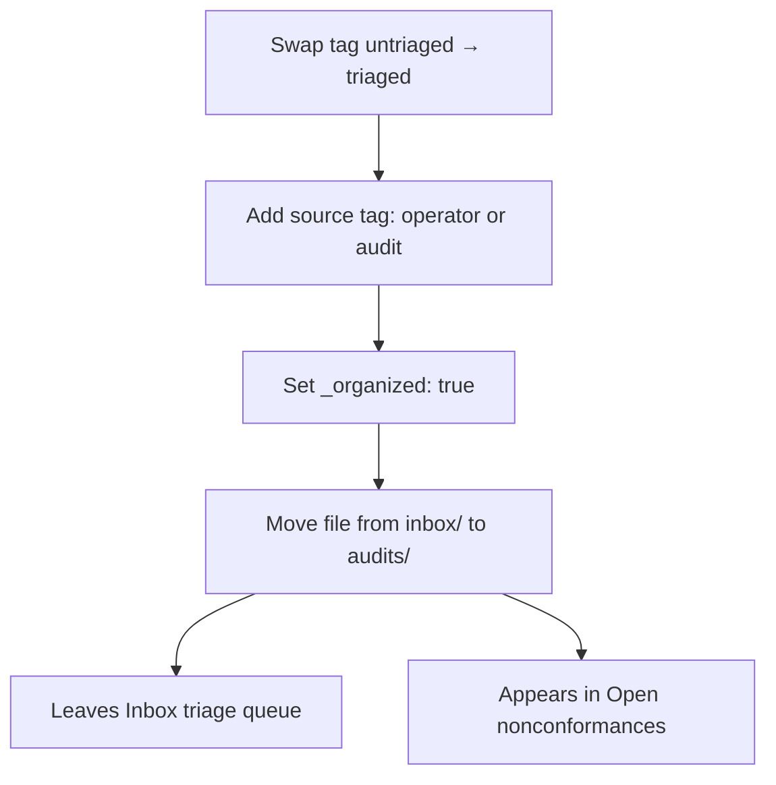

# 02.2.3 — Tags and move

**Question this page answers:** *How does the note leave the Inbox cleanly?*

## The pathway

## Analogy

> **Changing the ticket from 'unsorted' to 'in progress' and walking it to the right desk** — the queue updates because the label changed.

## Why / when / who / where

| | |
|---|---|
| **Why** | A stale tag would keep a closed item in the triage queue forever. |
| **When** | Immediately after the triage decision. |
| **Who** | QA engineer. |
| **Where** | File manager or Tolaria move; tags in frontmatter. |

## Try it

Compare the tags on [[NC-2026-11-19-002]] and [[NC-2026-11-19-001]].

## What you'll see in Tolaria

- tags contains drives the triage view
- Source is a tag, not a field
- Move is a filesystem change Tolaria picks up

## Go deeper

- [[NC-2026-11-19-002|Before]]
- [[NC-2026-11-19-001|After]]
- [[02.2-triage-into-a-finding|Parent]]

## Back

[[02.2-triage-into-a-finding]] — parent page · [[02-operate]] — tier overview · [[00-start-here]] — hub
