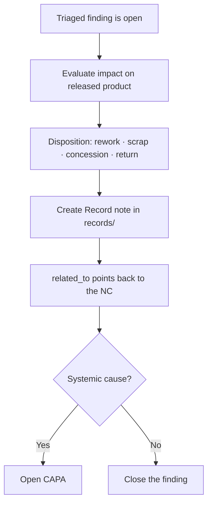

# 02.3 — Disposition and evidence

**Question this page answers:** *How do I prove that the action was actually carried out?*

## The pathway

## Analogy

> A **signed receipt at the delivery counter**. The procedure says what should happen; the record is the signature that it did.

## Why / when / who / where

| | |
|---|---|
| **Why** | Auditors ask 'you wrote the procedure — but did anyone do it?' Records answer that. |
| **When** | Immediately after the disposition decision. |
| **Who** | QA engineer performs; QA manager authorises; human closes. |
| **Where** | `records/`; SOP-QA-002 steps 3–6. |

## Try it

Open [[REC-NC-2026-11-19-001]] and trace it back through `related_to` to the NC and the SOP.

## What you'll see in Tolaria

- Record notes carry performed_on, not narrative fields
- Evidence text stays in the body
- The CAPA link is optional and conditional

## Go deeper

- [[REC-NC-2026-11-19-001|Worked disposition record]]
- [[Record|Record Type document]]
- [[SOP-QA-002|Procedure that defines the steps]]
- [[05.3-capa-lifecycle|When the cause is systemic]]

## Back

[[02-operate]] — parent pathway · [[00-start-here]] — hub
