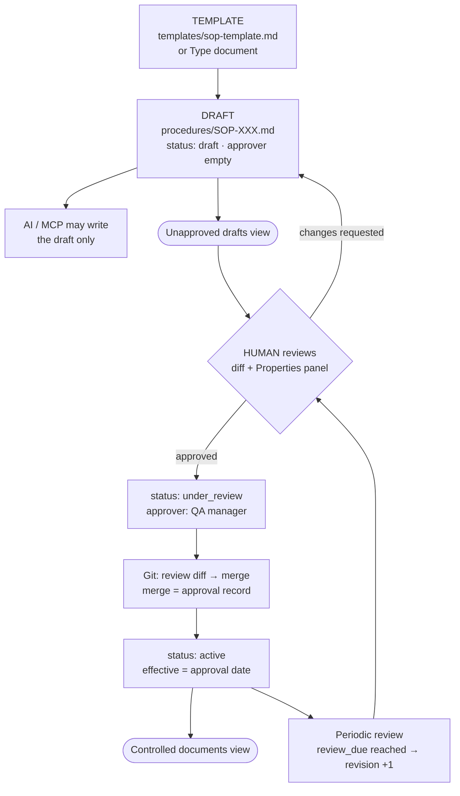

# 03 — Maintain: controlled documents

**Question this page answers:** *"How do I write a new SOP or revise an existing one without breaking control?"*

## The pathway

## Analogy

> **A notarised filing cabinet with a tamper-evident log.** The document is the paper; Git is the notary who records every change, who made it and when. A Word file called `final_v2_REAL_final(2).docx` is a shoebox. The template is the pre-printed form so you stop inventing the shape each time.

## Why / when / who / where

| | |
|---|---|
| **Why** | Auditors distinguish a *documented* control from an *effective* one. A rule enforced by a machine is effective by definition. |
| **When** | New process, a change request, a CAPA action, or an upcoming `review_due`. |
| **Who** | QA engineer drafts; QA manager approves; AI may assist only up to `draft`. |
| **Where** | `types/` (schema), `templates/` (forms), `policies/`, `procedures/`, `instructions/`; views `unapproved-drafts.yml`, `overdue-reviews.yml`. |

## Branches from here

- [[03.1-write-a-policy]] — top-level commitment
- [[03.2-write-an-sop]] — controlled procedure
- [[03.3-work-instructions]] — task-level detail
- [[03.4-revisions-and-git]] — versioning and approval
- [[03.5-templates-and-ai-drafting]] — drafting with assistance

## Go deeper

- [[sop-lifecycle]] — the two diagrams for template → controlled document
- [[sop-template]] — the source form
- [[ai-sop-draft-prompt]] — the prompt for the first transition
- [[POL-QUAL-001]] — a controlled policy with a revision history

## Back

[[00-start-here]] — return to the top-level map.
