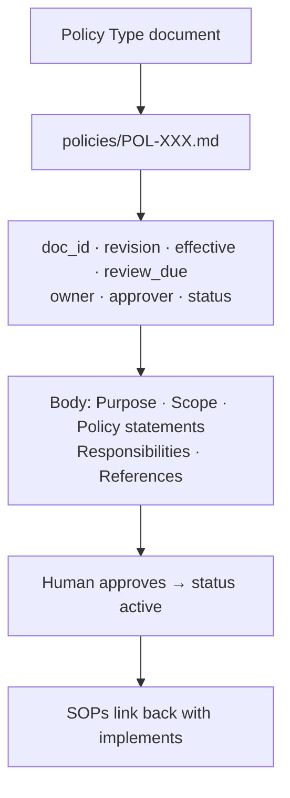

# 03.1 — Write a policy

**Question this page answers:** *Where does the top-level commitment live?*

## The pathway

## Analogy

> A **constitution, not a by-law**. The policy says what the organisation promises; the SOPs are the laws that implement it.

## Why / when / who / where

| | |
|---|---|
| **Why** | A policy proves top-level commitment and scope before any procedure exists. |
| **When** | When a new obligation, standard or business promise appears. |
| **Who** | QA director owns; QA manager approves. |
| **Where** | `policies/`; Type document `Policy`. |

## Try it

Open [[POL-QUAL-001]] and find the policy statements that [[SOP-QA-001]] implements.

## What you'll see in Tolaria

- Policy is a controlled document with revision and review date
- Clauses are cited as wikilinks into iso-9001/
- Body statement links make the traceability chain

## Go deeper

- [[POL-QUAL-001|Quality Policy]]
- [[POL-QUAL-002|Data Integrity Policy]]
- [[Policy|Policy Type document]]
- [[03.2-write-an-sop|Next layer down]]

## Back

[[03-maintain]] — parent pathway · [[00-start-here]] — hub
