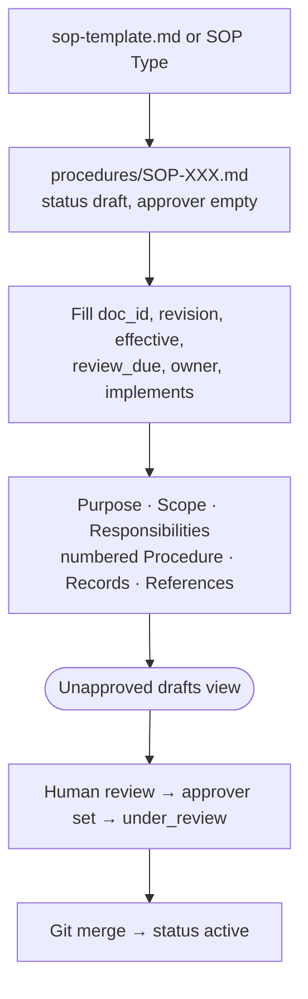

# 03.2 — Write an SOP

**Question this page answers:** *How do I create a controlled procedure that will pass review?*

## The pathway

## Analogy

> Like a **recipe printed on a numbered card**: the number tells you which edition you are holding, and the steps are testable.

## Why / when / who / where

| | |
|---|---|
| **Why** | Most QMS failures are format drift, not missing knowledge. A fixed shape kills that. |
| **When** | New process, CAPA action, or a review date coming due. |
| **Who** | QA engineer drafts; QA manager approves. |
| **Where** | `procedures/`; `types/SOP.md`; `templates/sop-template.md`. |

## Try it

Compare [[SOP-QA-001]] (active) with [[SOP-PROD-001]] (draft, no approver) in the Properties panel.

## What you'll see in Tolaria

- status active requires an approver
- implements points at the policy
- Old revisions survive in Git, not in the folder

## Level 3 branches

- [[03.2.1-drafting-the-sop]]
- [[03.2.2-reviewing-the-draft]]
- [[03.2.3-approving-and-activating]]
- [[03.2.4-periodic-review]]

## Go deeper

- [[SOP-QA-001|Active example]]
- [[SOP-PROD-001|Unapproved draft example]]
- [[sop-lifecycle|Full lifecycle diagram]]
- [[03.3-work-instructions|Next layer down]]

## Back

[[03-maintain]] — parent pathway · [[00-start-here]] — hub
