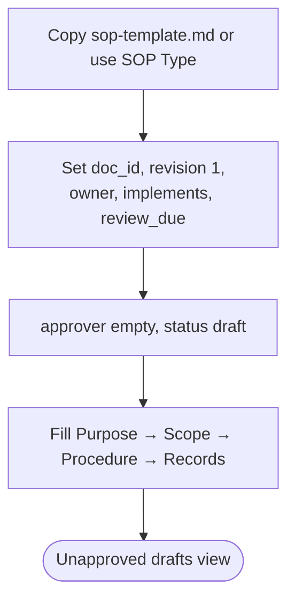

# 03.2.1 — Drafting the SOP

**Question this page answers:** *How do I get a first version onto disk?*

## The pathway

## Analogy

> **Building a house from an approved blueprint** — you may choose the furniture, but the walls and doors are already fixed.

## Why / when / who / where

| | |
|---|---|
| **Why** | A draft is allowed to be imperfect; the shape is not. |
| **When** | When a new process or a CAPA action requires a procedure. |
| **Who** | QA engineer, or an AI agent in draft mode. |
| **Where** | `templates/sop-template.md`, `types/SOP.md`. |

## Try it

Open [[SOP-PROD-001]] and list its frontmatter fields, noting the empty approver.

## What you'll see in Tolaria

- status draft is the safe state
- implements links the policy
- AI may draft but never activate

## Go deeper

- [[sop-template|Source form]]
- [[SOP-PROD-001|Draft example]]
- [[ai-sop-draft-prompt|Prompt for drafting]]

## Back

[[03.2-write-an-sop]] — parent page · [[03-maintain]] — tier overview · [[00-start-here]] — hub
