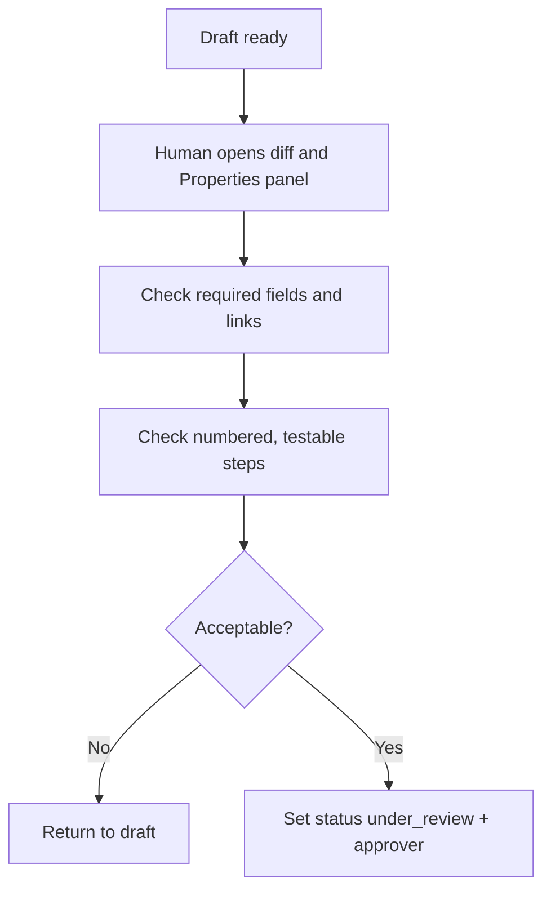

# 03.2.2 — Reviewing the draft

**Question this page answers:** *What does a reviewer actually check?*

## The pathway

## Analogy

> **The editor who checks the manuscript before the printing press** — VitePress is the press, the reviewer is the gate.

## Why / when / who / where

| | |
|---|---|
| **Why** | Review is the human control that turns text into a controlled document. |
| **When** | Before any promotion from draft. |
| **Who** | QA manager. |
| **Where** | Tolaria diff view; Properties panel. |

## Try it

Read [[SOP-QA-002]]'s review note and explain why rev 3 is still under_review.

## What you'll see in Tolaria

- AI edits are ordinary file edits
- Use the stop control if a stream drifts
- under_review is the waiting room

## Go deeper

- [[SOP-QA-002|Under-review example]]
- [[03.4.2-commit-conventions|Commit review]]
- [[sop-lifecycle|Gate in the diagram]]

## Back

[[03.2-write-an-sop]] — parent page · [[03-maintain]] — tier overview · [[00-start-here]] — hub
