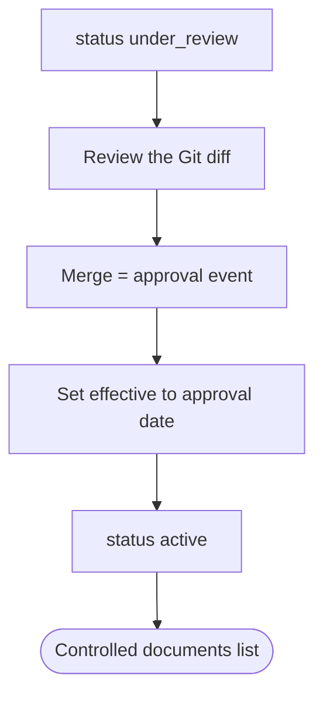

# 03.2.3 — Approving and activating

**Question this page answers:** *What formally makes an SOP current?*

## The pathway

## Analogy

> **The notary signing the deed** — until the signature lands, the document is a proposal; afterwards it is the record.

## Why / when / who / where

| | |
|---|---|
| **Why** | Git proves what changed; the approval step proves who agreed. |
| **When** | When the reviewer accepts the change. |
| **Who** | QA manager only. |
| **Where** | Git panel; Properties panel. |

## Try it

On [[SOP-QA-001]], find `approver`, `effective` and the revision history line.

## What you'll see in Tolaria

- active requires approver and effective
- The validator enforces this
- Old revisions remain in Git history

## Go deeper

- [[SOP-QA-001|Active SOP]]
- [[03.4.3-tags-and-rollback|Marking the snapshot]]
- [[04.4-validate-and-catch-drift|Guard]]

## Back

[[03.2-write-an-sop]] — parent page · [[03-maintain]] — tier overview · [[00-start-here]] — hub
