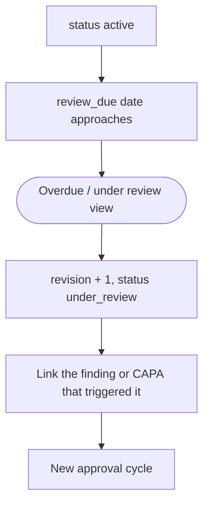

# 03.2.4 — Periodic review

**Question this page answers:** *How does a current SOP come back for review?*

## The pathway

## Analogy

> **A car's annual MOT** — the car still runs, but the certificate has an expiry date that forces a check.

## Why / when / who / where

| | |
|---|---|
| **Why** | A controlled document without a review date silently becomes obsolete. |
| **When** | When review_due is near or a CAPA requires a change. |
| **Who** | QA engineer proposes; QA manager approves. |
| **Where** | `review_due`; `views/overdue-reviews.yml`. |

## Try it

[[SOP-QA-002]] is past its review date — explain which view surfaces it.

## What you'll see in Tolaria

- review_due is a frontmatter date
- The view is computed, not remembered
- Revision increments on the same file

## Go deeper

- [[SOP-QA-002|Overdue example]]
- `views/overdue-reviews.yml` — View definition
- [[03.4.1-revision-numbering|How to bump]]

## Back

[[03.2-write-an-sop]] — parent page · [[03-maintain]] — tier overview · [[00-start-here]] — hub
