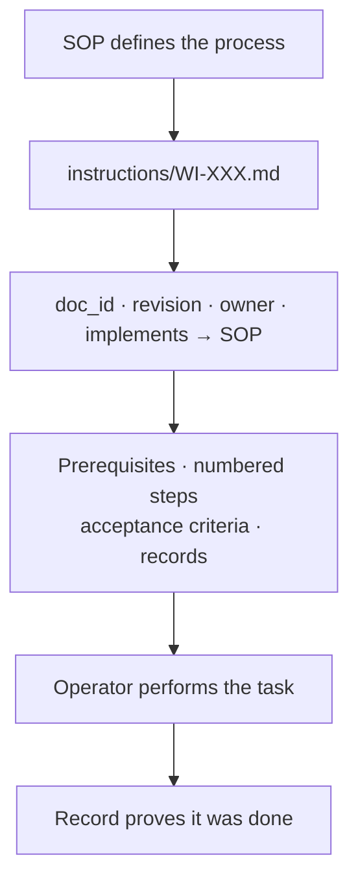

# 03.3 — Work instructions

**Question this page answers:** *When is a step too detailed for an SOP?*

## The pathway

## Analogy

> The SOP is the **chef's overview**; the work instruction is the **photo of exactly how to fold the box**.

## Why / when / who / where

| | |
|---|---|
| **Why** | One task, one operator, one acceptance test — easier to train and audit. |
| **When** | When a step needs exact button presses, formats or checks. |
| **Who** | Production owner writes; QA engineer approves. |
| **Where** | `instructions/`; Type `WorkInstruction`. |

## Try it

Open [[WI-PROD-003]] and find the acceptance criteria that make the task testable.

## What you'll see in Tolaria

- One note = one sheet, one task
- implements points to the parent SOP
- Acceptance criteria make compliance binary

## Go deeper

- [[WI-PROD-003|Label verification instruction]]
- [[WorkInstruction|Type document]]
- [[SOP-PROD-001|Parent SOP]]

## Back

[[03-maintain]] — parent pathway · [[00-start-here]] — hub
