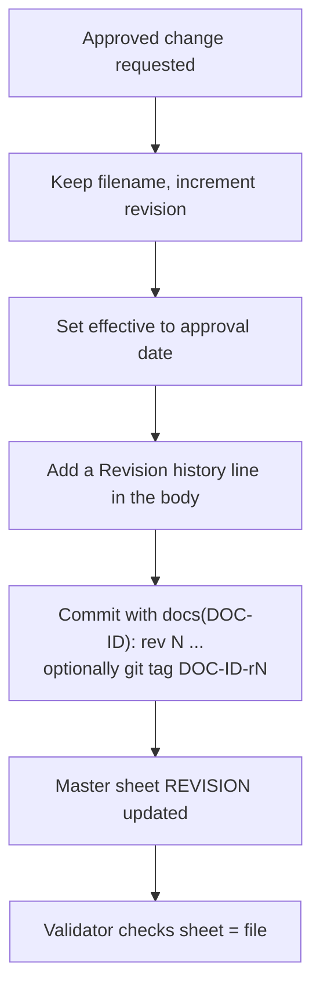

# 03.4 — Revisions and Git

**Question this page answers:** *How is versioning actually tracked?*

## The pathway

## Analogy

> A **notary's log with a page you can always pull from the archive**. Git records who changed what, when; the revision number tells a human which edition they hold.

## Why / when / who / where

| | |
|---|---|
| **Why** | `doc_id` is permanent identity; `revision` is version. Confusing them creates phantom documents. |
| **When** | Every approved change; before an audit that asks 'show me rev 3'. |
| **Who** | QA manager approves; Git is the machine record. |
| **Where** | File frontmatter, body Revision history, Git history, `scripts/validate-vault.py`. |

## Try it

Run `python3 scripts/validate-vault.py` and see that sheet and file revisions agree.

## What you'll see in Tolaria

- Never rename a doc_id — links and history break
- A tag marks an approved snapshot
- The validator fails on drift

## Level 3 branches

- [[03.4.1-revision-numbering]]
- [[03.4.2-commit-conventions]]
- [[03.4.3-tags-and-rollback]]
- [[03.4.4-sheet-synchronisation]]

## Go deeper

- [[POL-QUAL-001|Document with a revision history]]
- [[07.4-git-as-audit-trail|Git as the audit answer]]
- [[sop-lifecycle|Approval gate in the lifecycle]]

## Back

[[03-maintain]] — parent pathway · [[00-start-here]] — hub
