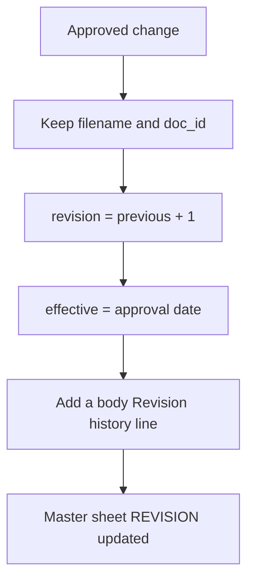

# 03.4.1 — Revision numbering

**Question this page answers:** *How do I increment a version without creating a new document?*

## The pathway

## Analogy

> **The edition number on a book cover** — same title, same ISBN, new edition. You do not invent a new book.

## Why / when / who / where

| | |
|---|---|
| **Why** | doc_id is identity; revision is version. Mixing them creates phantom documents. |
| **When** | Every approved change. |
| **Who** | QA manager. |
| **Where** | File frontmatter, body history, master sheet. |

## Try it

Find rev 3 in [[SOP-QA-002]]'s revision history and check the sheet row.

## What you'll see in Tolaria

- Never rename the file
- Body history is the human story
- Sheet drift is caught by the validator

## Go deeper

- [[SOP-QA-002|Rev 3 draft]]
- [[document-master.sheet|Index to keep in sync]]
- [[04.4-validate-and-catch-drift|Check]]

## Back

[[03.4-revisions-and-git]] — parent page · [[03-maintain]] — tier overview · [[00-start-here]] — hub
