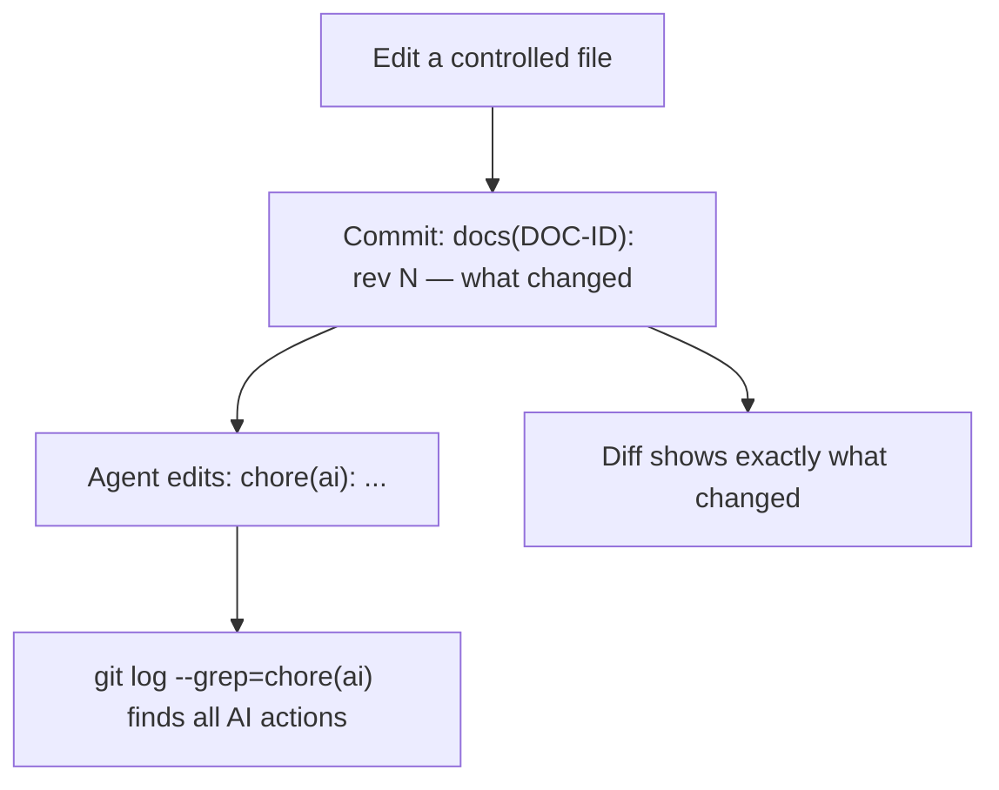

# 03.4.2 — Commit conventions

**Question this page answers:** *What makes a commit useful to an auditor?*

## The pathway

## Analogy

> **A labelled evidence bag** — the label tells you which case it belongs to before you open it.

## Why / when / who / where

| | |
|---|---|
| **Why** | A commit message is part of the audit trail, not a note to self. |
| **When** | Every change, especially agent-written ones. |
| **Who** | Anyone committing; QA reviews. |
| **Where** | Git panel or CLI. |

## Try it

Imagine the commit message for bumping [[SOP-QA-002]] to rev 3.

## What you'll see in Tolaria

- Prefix AI commits with chore(ai):
- Name the doc_id and revision
- Keep messages factual, not vague

## Go deeper

- `AGENTS.md` — Agent commit rule in AGENTS.md
- [[sop-lifecycle|Merge as approval]]
- [[03.4.3-tags-and-rollback|Next]]

## Back

[[03.4-revisions-and-git]] — parent page · [[03-maintain]] — tier overview · [[00-start-here]] — hub
