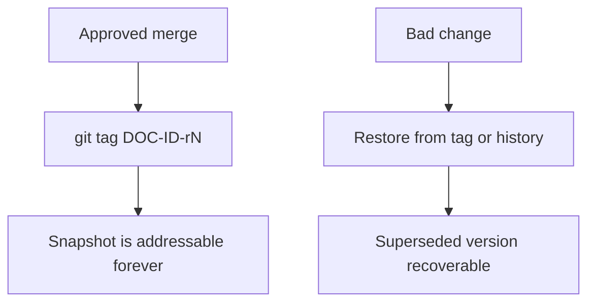

# 03.4.3 — Tags and rollback

**Question this page answers:** *How do I mark an approved snapshot or undo a change?*

## The pathway

## Analogy

> **A photo in the archive plus a rewind button** — the photo marks the moment, the rewind lets you return to it.

## Why / when / who / where

| | |
|---|---|
| **Why** | Regulators love 'show me exactly what rev 3 said'. A tag answers in one command. |
| **When** | At approval; when a change must be undone. |
| **Who** | QA manager; Git-capable users. |
| **Where** | Git CLI; Tolaria Git panel for history. |

## Try it

Describe the tag you would create for [[POL-QUAL-001]] rev 3.

## What you'll see in Tolaria

- Tags are immutable pointers
- Git alone is not e-signature
- Rollback is diffable and visible

## Go deeper

- [[POL-QUAL-001|Controlled policy]]
- [[03.4-revisions-and-git|Parent]]
- [[07.4-git-as-audit-trail|Audit framing]]

## Back

[[03.4-revisions-and-git]] — parent page · [[03-maintain]] — tier overview · [[00-start-here]] — hub
