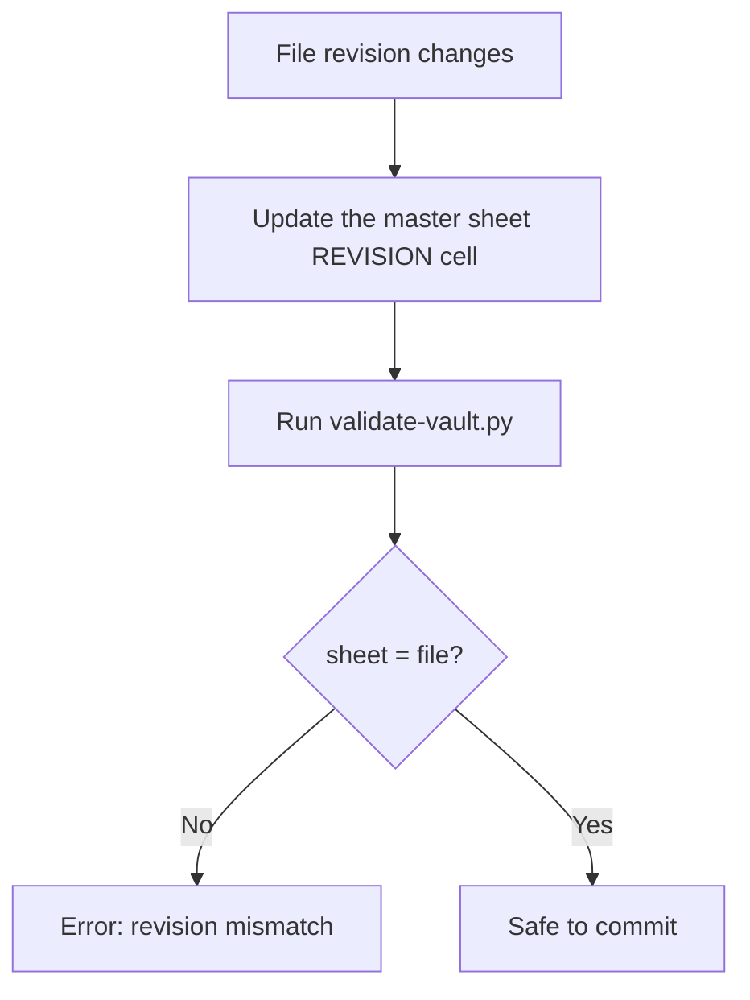

# 03.4.4 — Sheet synchronisation

**Question this page answers:** *How do I stop the register from lying?*

## The pathway

## Analogy

> **Two clocks in the same room** — if they disagree, nobody knows the time. The validator is the person who compares them.

## Why / when / who / where

| | |
|---|---|
| **Why** | You already saw drift: the sheet said rev 2 while the file was rev 3. |
| **When** | Before every commit. |
| **Who** | QA manager or an agent. |
| **Where** | `registers/document-master.sheet.md`; `scripts/validate-vault.py`. |

## Try it

Run the validator and confirm zero errors.

## What you'll see in Tolaria

- The sheet is an index, not truth
- Mismatch is a hard error
- Duplicate IDs are also caught

## Go deeper

- [[document-master.sheet|The register]]
- [[04.4-validate-and-catch-drift|Validator overview]]
- [[03.4.1-revision-numbering|Where drift starts]]

## Back

[[03.4-revisions-and-git]] — parent page · [[03-maintain]] — tier overview · [[00-start-here]] — hub
