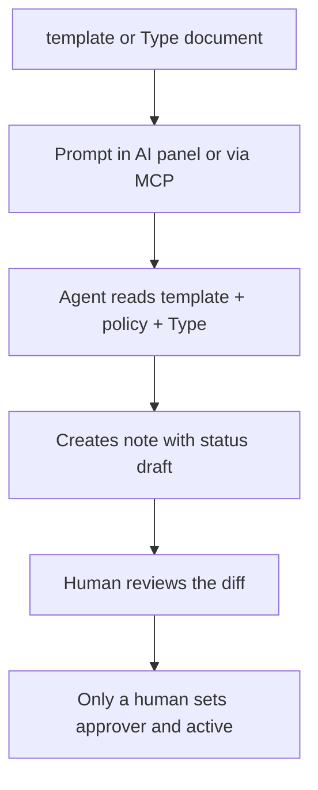

# 03.5 — Templates and AI drafting

**Question this page answers:** *Can an assistant write the first draft for me?*

## The pathway

## Analogy

> An **intern with the approved form library**: helpful and fast, but every output is a draft until a qualified person signs it.

## Why / when / who / where

| | |
|---|---|
| **Why** | First drafts are grunt work; accountability stays human. |
| **When** | When drafting a new SOP or CAPA from a known template. |
| **Who** | QA engineer prompts; QA manager approves; agent drafts only. |
| **Where** | AI panel (`Cmd+Shift+L`), inline prompt (`Cmd+K` + space), `templates/ai-sop-draft-prompt.md`. |

## Try it

Open the prompt template and identify the hard rule that forbids `status: active`.

## What you'll see in Tolaria

- Direct model targets are chat-only and cannot write files
- Vault Safe coding agents can edit files
- AGENTS.md is the agent's rulebook

## Level 3 branches

- [[03.5.1-prompt-anatomy]]
- [[03.5.2-panel-or-inline]]
- [[03.5.3-external-mcp]]
- [[03.5.4-reviewing-ai-drafts]]

## Go deeper

- [[ai-sop-draft-prompt|Copy-paste prompt]]
- [[sop-template|Source form]]
- [[07.3-permissions-and-ai-mcp|Permission boundary]]

## Back

[[03-maintain]] — parent pathway · [[00-start-here]] — hub
