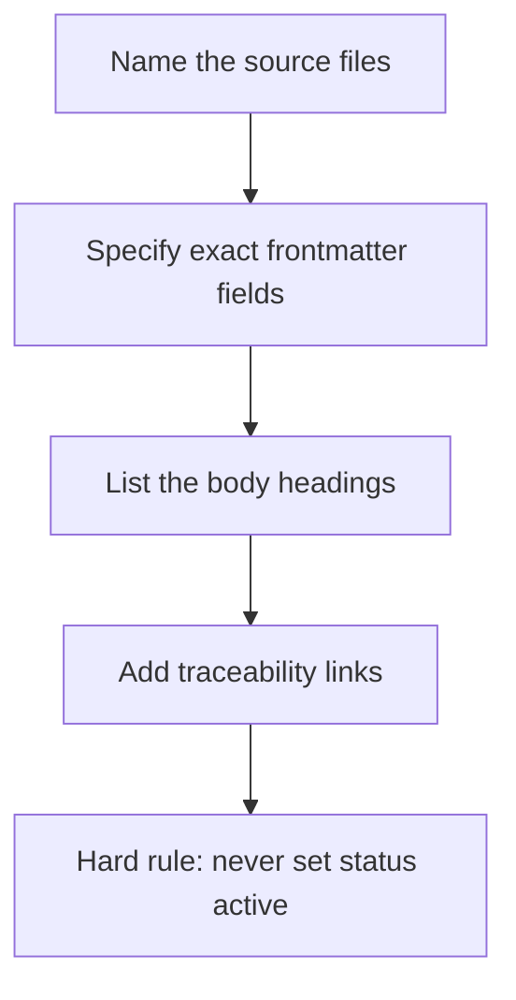

# 03.5.1 — Prompt anatomy

**Question this page answers:** *What makes an AI drafting prompt reliable?*

## The pathway

## Analogy

> **A work order for an intern**: name the manuals, the form, the fields, and the one thing they must never do.

## Why / when / who / where

| | |
|---|---|
| **Why** | Vague prompts produce plausible but uncontrol­lable documents. |
| **When** | Any time you ask an agent to draft a QMS note. |
| **Who** | QA engineer writes the prompt; agent follows it. |
| **Where** | `templates/ai-sop-draft-prompt.md`. |

## Try it

Identify the four parts of the prompt template.

## What you'll see in Tolaria

- Name files so the agent reads real context
- Use canonical field names
- Repeat the human-only rule

## Go deeper

- [[ai-sop-draft-prompt|The prompt template]]
- [[sop-template|Target form]]
- [[03.5.2-panel-or-inline|Where to paste it]]

## Back

[[03.5-templates-and-ai-drafting]] — parent page · [[03-maintain]] — tier overview · [[00-start-here]] — hub
