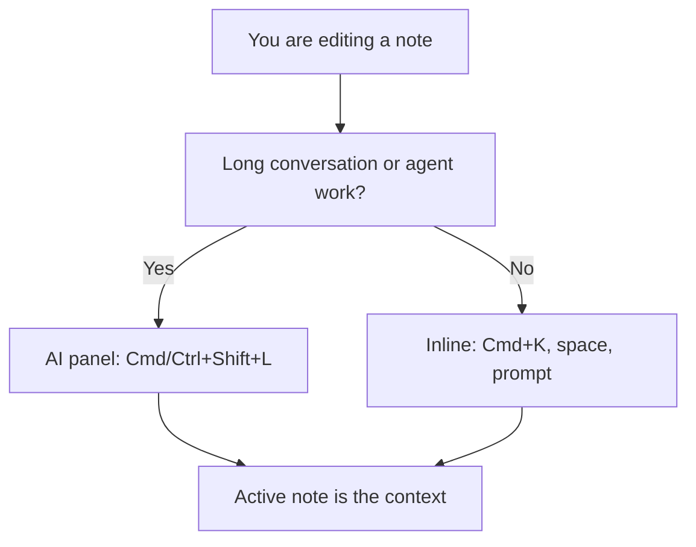

# 03.5.2 — Panel or inline

**Question this page answers:** *Where do I talk to the assistant?*

## The pathway

## Analogy

> **A meeting room versus a sticky note** — the panel is for a long session, inline is for one quick question while writing.

## Why / when / who / where

| | |
|---|---|
| **Why** | Context is the active note; choose the surface that fits the job. |
| **When** | Any drafting or analysis request. |
| **Who** | Everyone with an AI target configured. |
| **Where** | Settings → AI; AI panel; inline prompt. |

## Try it

Open the AI panel with the SOP template active and ask it to summarise the required sections.

## What you'll see in Tolaria

- Direct models are chat-only
- Coding agents can edit files
- Stop control ends a runaway stream

## Go deeper

- [[sop-template|Context note]]
- [[03.5.3-external-mcp|Other path]]
- [[03.5-templates-and-ai-drafting|Parent]]

## Back

[[03.5-templates-and-ai-drafting]] — parent page · [[03-maintain]] — tier overview · [[00-start-here]] — hub
