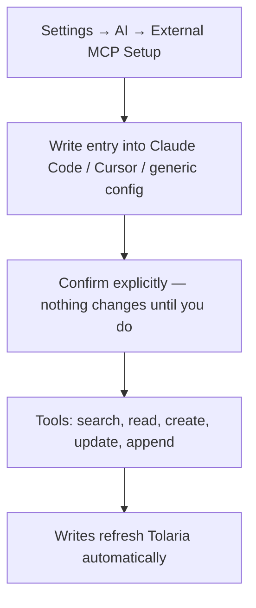

# 03.5.3 — External MCP

**Question this page answers:** *How do I connect an outside assistant to the vault?*

## The pathway

## Analogy

> **Issuing a badge to an outside contractor** — you decide which doors it opens, and the app writes it down explicitly.

## Why / when / who / where

| | |
|---|---|
| **Why** | MCP setup is powerful and deliberate; it must not happen silently. |
| **When** | When using Claude Code, Cursor or another MCP client. |
| **Who** | QA manager with approval from QA director. |
| **Where** | Settings → AI; external client config. |

## Try it

Describe what the setup dialog writes and why explicit confirmation matters.

## What you'll see in Tolaria

- update_note has a modification-time guard
- Start read-only, then add write tools
- Vet third-party servers before write access

## Go deeper

- `AGENTS.md` — Rules in AGENTS.md
- [[ai-sop-draft-prompt|Prompt to use]]
- [[07.3-permissions-and-ai-mcp|Governance]]

## Back

[[03.5-templates-and-ai-drafting]] — parent page · [[03-maintain]] — tier overview · [[00-start-here]] — hub
