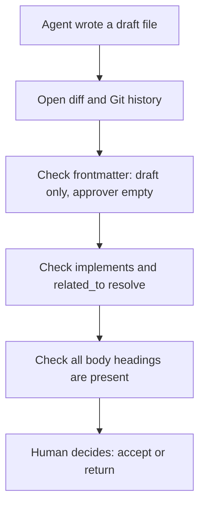

# 03.5.4 — Reviewing AI drafts

**Question this page answers:** *What must a human verify before accepting a draft?*

## The pathway

## Analogy

> **Proofreading a intern's work before it goes to the customer** — you do not rewrite it all, you check the things that matter.

## Why / when / who / where

| | |
|---|---|
| **Why** | AI output is an unverified draft until a named human owns it. |
| **When** | Immediately after any agent write. |
| **Who** | QA manager. |
| **Where** | Tolaria diff view; Properties panel; validator. |

## Try it

Use the checklist on [[ai-sop-draft-prompt]] to review a hypothetical draft.

## What you'll see in Tolaria

- Commit prefix marks provenance
- Never let an agent set active
- The validator catches broken links

## Go deeper

- [[ai-sop-draft-prompt|Checklist source]]
- [[SOP-PROD-001|Draft example]]
- [[04.4-validate-and-catch-drift|Automated check]]

## Back

[[03.5-templates-and-ai-drafting]] — parent page · [[03-maintain]] — tier overview · [[00-start-here]] — hub
