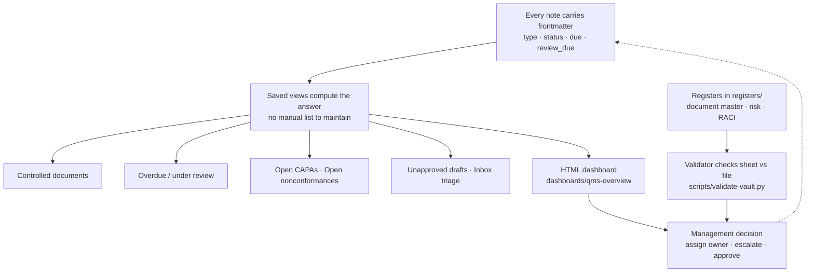

# 04 — Monitor: the control tower

**Question this page answers:** *"What is overdue, open, draft, or drifting right now?"*

## The pathway

## Analogy

> **The control tower and the planes.** The notes are the planes; the views are the tower screens saying which plane is late for maintenance. Better still, it is a **turnstile that counts automatically** — the status is computed from the files, so it cannot be forgotten by a human maintaining a spreadsheet.

## Why / when / who / where

| | |
|---|---|
| **Why** | Document control done by memory is a finding waiting to happen. Computed state is always current. |
| **When** | Daily at the start of the shift; before an audit; before committing changes. |
| **Who** | QA manager reviews; stakeholders read the dashboards and register summaries. |
| **Where** | `views/*.yml`, `registers/*.sheet.md`, `dashboards/qms-overview.md`, `scripts/validate-vault.py`. |

## Branches from here

- [[04.1-build-a-saved-view]] — make a question reusable
- [[04.2-register-sheets]] — readable registers
- [[04.3-the-dashboard]] — status at a glance
- [[04.4-validate-and-catch-drift]] — the machine guard

## Go deeper

- [[qms-overview]] — the frontmatter-driven HTML dashboard
- [[document-master.sheet]] — the controlled-document index
- [[risk-register.sheet]] — risk scores with sheet formulas
- [[raci-obligations.sheet]] — rights and duties matrix

## Back

[[00-start-here]] — return to the top-level map.
