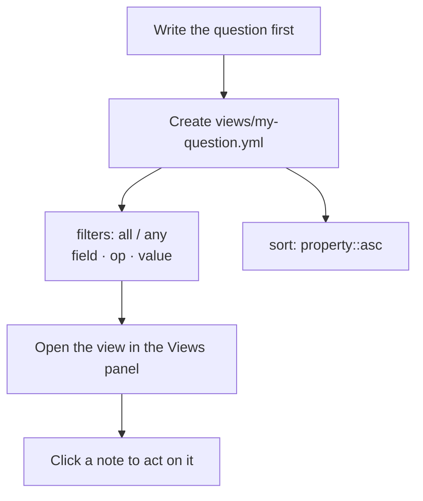

# 04.1 — Build a saved view

**Question this page answers:** *How do I make a question reusable?*

## The pathway

## Analogy

> A view is a **saved camera angle on the control tower**. You do not move the planes to see them differently; you just point the camera.

## Why / when / who / where

| | |
|---|---|
| **Why** | A good view answers one recurring question; a broad view answers none. |
| **When** | When you catch yourself opening the same three notes every morning. |
| **Who** | QA manager builds; everyone reads. |
| **Where** | `views/*.yml`. |

## Try it

Open `views/open-capas.yml` and rewrite its question in one sentence.

## What you'll see in Tolaria

- Filters use equals / contains
- Relative dates exist but verify the operator in-app
- Views are files, so they are version-controlled too

## Go deeper

- [[document-master.sheet|Data behind many views]]
- [[qms-overview|Alternative presentation]]
- [[01.3-views-and-navigation|How to use views]]

## Back

[[04-monitor]] — parent pathway · [[00-start-here]] — hub
