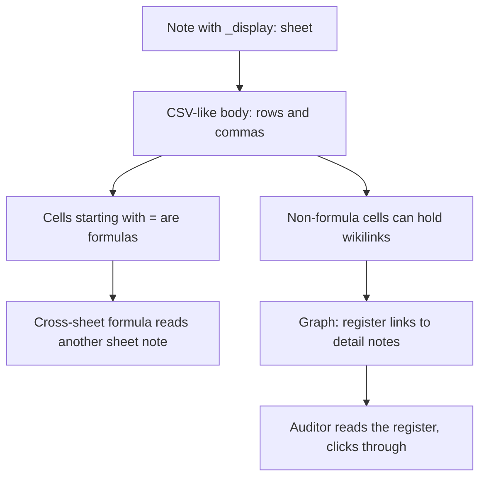

# 04.2 — Register sheets

**Question this page answers:** *How do I keep a readable register without losing the graph?*

## The pathway

## Analogy

> The spreadsheet is the **control tower**, the notes are the **planes**. The tower tells you which plane is late; the logbook holds the detail.

## Why / when / who / where

| | |
|---|---|
| **Why** | Registers give auditors a single list while notes keep the evidence graph intact. |
| **When** | Document master, risk, RACI — anything better modelled as rows. |
| **Who** | QA manager maintains; auditors and leadership read. |
| **Where** | `registers/*.sheet.md`. |

## Try it

Open [[risk-register.sheet]] and find the `=C2*D2` risk-score formula.

## What you'll see in Tolaria

- Sheet notes are still Markdown with frontmatter
- _sheet holds presentation state only
- A sheet is an index, not a second source of truth

## Level 3 branches

- [[04.2.1-csv-body]]
- [[04.2.2-formulas]]
- [[04.2.3-wikilinks-in-cells]]
- [[04.2.4-sheet-metadata]]

## Go deeper

- [[risk-register.sheet|Formulas example]]
- [[raci-obligations.sheet|Wikilinks in cells]]
- [[document-master.sheet|Master index]]

## Back

[[04-monitor]] — parent pathway · [[00-start-here]] — hub
