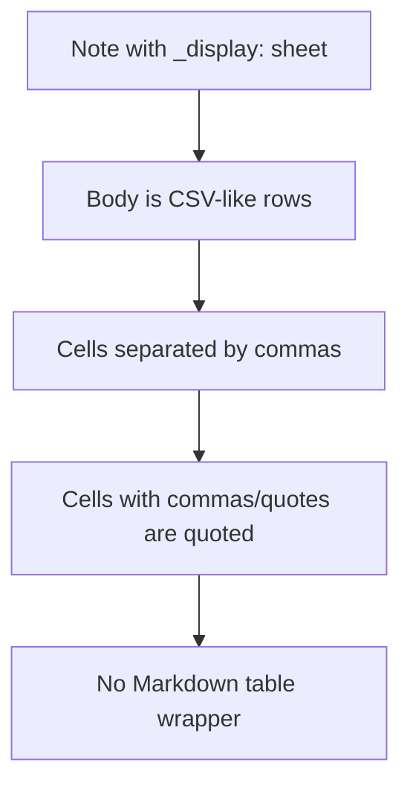

# 04.2.1 — CSV body

**Question this page answers:** *How is a spreadsheet actually stored?*

## The pathway

## Analogy

> **Plain text in a spreadsheet costume** — you can open it in any editor, diff it in Git, and still see a grid in Tolaria.

## Why / when / who / where

| | |
|---|---|
| **Why** | A sheet must stay readable and diffable, not an opaque workbook blob. |
| **When** | When editing a register by hand or script. |
| **Who** | QA manager; agents. |
| **Where** | Raw mode on a `*.sheet.md` note. |

## Try it

Open [[risk-register.sheet]] in raw mode and see the CSV rows.

## What you'll see in Tolaria

- One note = one sheet
- Empty trailing rows may be omitted
- Scripts must parse CSV, not split on commas

## Go deeper

- [[risk-register.sheet|CSV example]]
- [[document-master.sheet|Master list]]
- [[04.2-register-sheets|Parent]]

## Back

[[04.2-register-sheets]] — parent page · [[04-monitor]] — tier overview · [[00-start-here]] — hub
