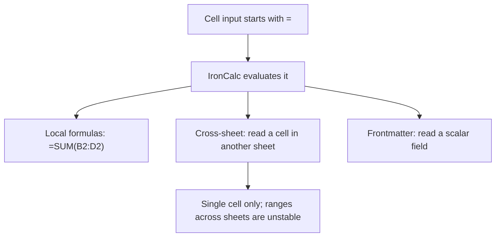

# 04.2.2 — Formulas

**Question this page answers:** *How do registers calculate anything?*

## The pathway

## Analogy

> **A calculator built into the grid** — the formula is stored, not its last answer, so the value stays current.

## Why / when / who / where

| | |
|---|---|
| **Why** | Calculated columns replace hand-tallied numbers that drift. |
| **When** | When a register needs scores, totals or live status. |
| **Who** | QA manager. |
| **Where** | Sheet editor; `*.sheet.md` body. |

## Try it

Find `=C2*D2` in [[risk-register.sheet]] and explain what it computes.

## What you'll see in Tolaria

- Never convert a formula to its displayed value
- Cross-sheet reads one cell
- Frontmatter reads one scalar

## Go deeper

- [[risk-register.sheet|Risk score formulas]]
- [[document-master.sheet|Index sheet]]
- [[04.2-register-sheets|Parent]]

## Back

[[04.2-register-sheets]] — parent page · [[04-monitor]] — tier overview · [[00-start-here]] — hub
