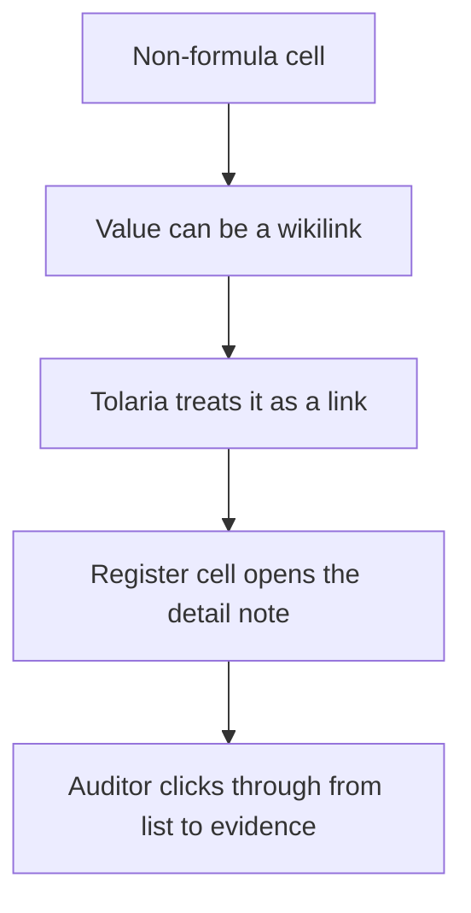

# 04.2.3 — Wikilinks in cells

**Question this page answers:** *Can a register cell link to a document?*

## The pathway

## Analogy

> **A hyperlink in a spreadsheet cell** — the table stays a table, but each row can take you to the underlying story.

## Why / when / who / where

| | |
|---|---|
| **Why** | The register is the index; the note is the evidence. Links keep that distinction. |
| **When** | When adding a row to a register. |
| **Who** | QA manager. |
| **Where** | Sheet editor; `raci-obligations.sheet.md`. |

## Try it

Open [[raci-obligations.sheet]] and click an owner cell.

## What you'll see in Tolaria

- Alias syntax works in cells
- Formula cells cannot hold wikilinks
- Links keep the register from becoming a duplicate source

## Go deeper

- [[raci-obligations.sheet|Wikilinks in cells]]
- [[qa-manager|Linked role]]
- [[04.2-register-sheets|Parent]]

## Back

[[04.2-register-sheets]] — parent page · [[04-monitor]] — tier overview · [[00-start-here]] — hub
