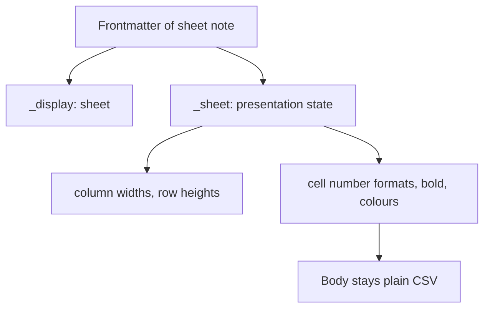

# 04.2.4 — Sheet metadata

**Question this page answers:** *Where do widths, colours and formats live?*

## The pathway

## Analogy

> **The display settings are in the frame, not the painting** — you can change the frame without touching the artwork.

## Why / when / who / where

| | |
|---|---|
| **Why** | Presentation must not corrupt the underlying data. |
| **When** | When a register is hard to read or a date shows wrongly. |
| **Who** | QA manager. |
| **Where** | Raw mode, `_sheet` block. |

## Try it

Look at the `_sheet` block in [[risk-register.sheet]] and find one column width.

## What you'll see in Tolaria

- Keys starting with _ are system fields
- Nested keys under _sheet are system-owned
- Scripts should leave _sheet untouched if unsure

## Go deeper

- [[risk-register.sheet|_sheet example]]
- [[document-master.sheet|Frozen rows]]
- [[04.2-register-sheets|Parent]]

## Back

[[04.2-register-sheets]] — parent page · [[04-monitor]] — tier overview · [[00-start-here]] — hub
