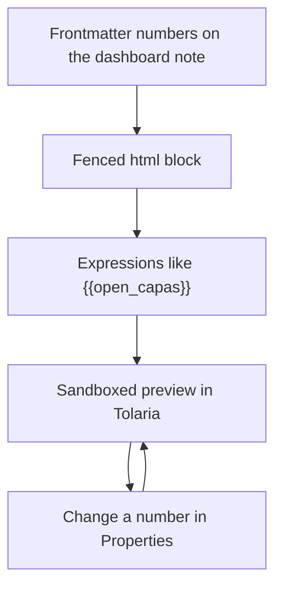

# 04.3 — The dashboard

**Question this page answers:** *How do managers see status without opening every note?*

## The pathway

## Analogy

> A **stock ticker fed by one edited number**: nobody writes a separate report; the display follows the file.

## Why / when / who / where

| | |
|---|---|
| **Why** | Same source data, no duplicated report to drift. |
| **When** | Daily stand-up or management review. |
| **Who** | QA manager updates; leadership reads. |
| **Where** | `dashboards/qms-overview.md`. |

## Try it

Open the dashboard, change `open_capas` in the Properties panel and watch the card update.

## What you'll see in Tolaria

- No plugin, no server
- Values are demo frontmatter today
- A build script could compute them later

## Go deeper

- [[qms-overview|The dashboard note]]
- [[04.4-validate-and-catch-drift|Guard against stale numbers]]

## Back

[[04-monitor]] — parent pathway · [[00-start-here]] — hub
