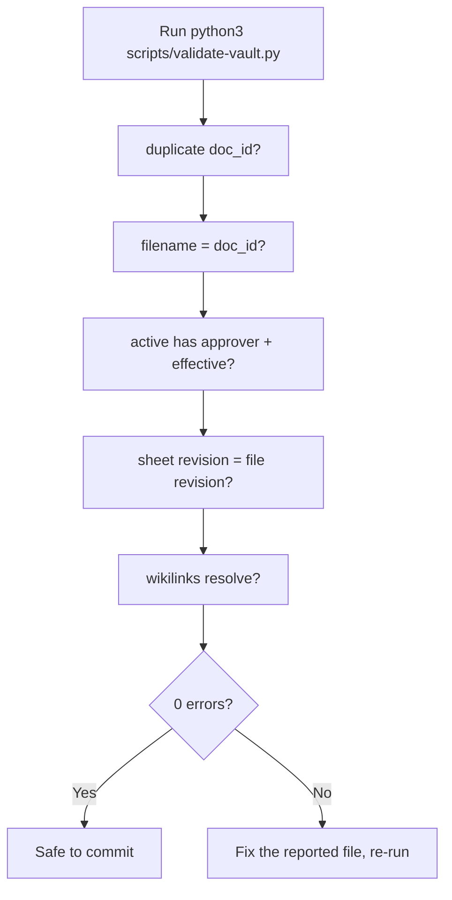

# 04.4 — Validate and catch drift

**Question this page answers:** *How do I know the register still matches the files?*

## The pathway

## Analogy

> A **security guard checking IDs before the printing press starts**. The rule is enforced by a machine, not by memory.

## Why / when / who / where

| | |
|---|---|
| **Why** | A documented control is not the same as an effective control. |
| **When** | Before every commit; in CI later. |
| **Who** | QA manager or an agent; the script is neutral. |
| **Where** | `scripts/validate-vault.py`. |

## Try it

Run it now. It should report 84 notes, 0 errors.

## What you'll see in Tolaria

- Standard-library Python, no dependencies
- Exit code 1 on errors
- Warnings do not fail the build

## Level 3 branches

- [[04.4.1-identity-checks]]
- [[04.4.2-control-checks]]
- [[04.4.3-link-checks]]
- [[04.4.4-ci-next-step]]

## Go deeper

- [[document-master.sheet|Sheet checked against files]]
- [[SOP-QA-002|Revision 3 kept in sync]]
- [[03.4-revisions-and-git|Versioning rules]]

## Back

[[04-monitor]] — parent pathway · [[00-start-here]] — hub
