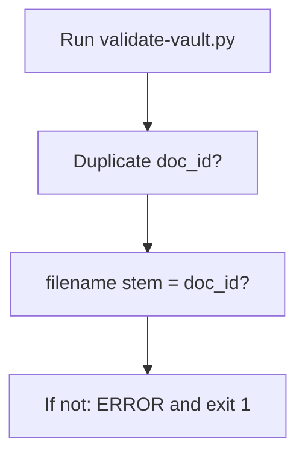

# 04.4.1 — Identity checks

**Question this page answers:** *How does the guard catch duplicate or renamed documents?*

## The pathway

## Analogy

> **Checking that every person in the room has a unique, correct name badge** — two badges with the same number is a problem.

## Why / when / who / where

| | |
|---|---|
| **Why** | Identity errors silently corrupt traceability. |
| **When** | Before every commit. |
| **Who** | Anyone; the script is neutral. |
| **Where** | `scripts/validate-vault.py`. |

## Try it

Run the script and read its first summary line.

## What you'll see in Tolaria

- Register notes are exempt from filename matching
- Type-doc null placeholders are ignored
- Exit code 1 stops CI

## Go deeper

- [[document-master.sheet|Index checked]]
- [[03.4.1-revision-numbering|Identity rules]]
- [[04.4-validate-and-catch-drift|Parent]]

## Back

[[04.4-validate-and-catch-drift]] — parent page · [[04-monitor]] — tier overview · [[00-start-here]] — hub
