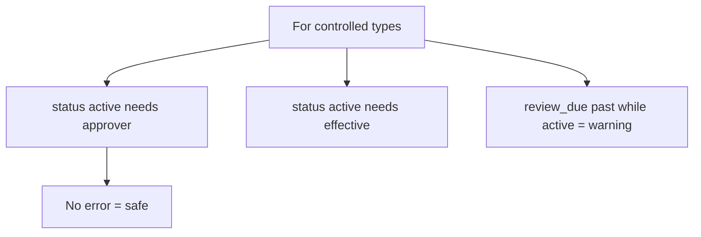

# 04.4.2 — Control checks

**Question this page answers:** *How does the guard enforce approval rules?*

## The pathway

## Analogy

> **The security guard checking IDs before the printing press** — the rule is mechanical, not a matter of memory.

## Why / when / who / where

| | |
|---|---|
| **Why** | This is what turns a documented control into an effective one. |
| **When** | Before committing document changes. |
| **Who** | QA manager; CI. |
| **Where** | `scripts/validate-vault.py`. |

## Try it

Explain why [[SOP-PROD-001]] is not an error: status is draft.

## What you'll see in Tolaria

- Warnings do not fail the build
- Only Policy/SOP/WI are checked
- The rule mirrors AGENTS.md

## Go deeper

- [[SOP-PROD-001|Draft example]]
- [[SOP-QA-001|Active example]]
- `AGENTS.md` — Human-only rule

## Back

[[04.4-validate-and-catch-drift]] — parent page · [[04-monitor]] — tier overview · [[00-start-here]] — hub
